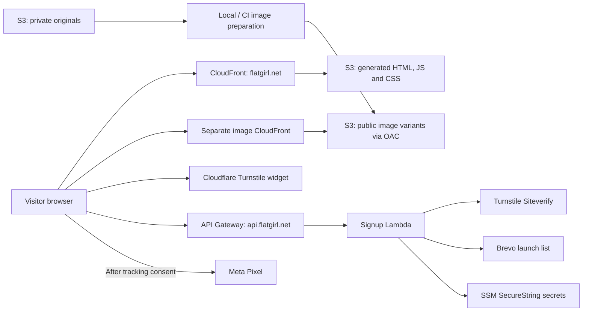

# Boring Flat Girl — implementation roadmap

Planning baseline: November 5, 2026. All five milestones are pending.
This document is the cross-session summary; detailed implementation plans belong
in their respective future sessions. No infrastructure has been inspected live
or changed as part of this planning work.

## Product and scope

**Boring Flat Girl** is a physical meme gift inspired by the childhood
Above the Influence commercials depicting Sarah as flat and boring after smoking
pot. The site should resemble a normal single-product page: prominent product
photography, a clear description, product details, and useful FAQs. Its primary
action is **“Notify me when it drops”**, replacing price and purchase controls.

The canonical domain is `https://flatgirl.net`; `www` redirects to it.
The first drop contains **500 units** on Black Friday. Assuming the upcoming
2026 holiday, the release date is **November 27, 2026**; the year and exact
release time/timezone still need confirmation. The user confirmed the promise
means **arrival before Christmas**, not merely dispatch before Christmas.
Eligible shipping destinations and any order cutoff remain to be specified.

Signing up requests a notification. It does not reserve one of the 500 units.
Do not cap the mailing list at 500 or imply that signup guarantees inventory.
Use only supplied product facts; dimensions, materials, included items, final
photography, and guarantee terms are not yet established.

Initial scope is one product landing page, with accessible privacy information
and tracking controls as needed. Excluded: checkout, payments, inventory
allocation, customer accounts, CMS, and a production Nuxt server. The Black
Friday sales destination and launch email campaign are separate work that must
be arranged before the drop; collecting addresses alone does not send a launch
notification or enable sales.

## Reference projects and reuse

| Reference | Reuse | Adaptation required |
| --- | --- | --- |
| `/Users/brucewilcoxon/BigNaturalsFoodCo/website/web/` | Nuxt static generation, TypeScript, Tailwind, accessible signup form and browser tests | Product-page layout, Flat Girl branding, metadata, copy, and image integration |
| Big Naturals `cloud/aws/` and `cloud/` runbooks | CDK, private S3/OAC/CloudFront, DNS/TLS, API/Lambda, SSM secrets, publication and verification scripts | Dedicated project configuration and resources; manual-first setup and permissions |
| Big Naturals `.github/workflows/deploy.yml` | Build artifact promotion, OIDC, main-only deployment, serialization and public verification | Flat Girl repository trust, image preparation, and first successful workflow validation |
| `/Users/brucewilcoxon/Polis/2045-FishLamps/Site/` | Separate private originals and public image variants, immutable image CDN, local image mode, manifest/recipes and verification receipt | Extract the image subsystem without archive/reviews, beta hosting, Shopify migration or unrelated application features |

Big Naturals' checked-in notes report successful local static hosting, but
signup recovery and GitHub integration verification remain pending. Treat that
code as a reference, not proof that its entire deployment works. Inspect current
source and dependency lockfiles when implementing; do not blindly copy versions,
account IDs, provider lists, resource names, secrets, or historical recovery steps.

FishLamps entry points: `cloud/IMAGES.md`, `web/ASSETS.md`,
`cloud/aws/lib/source-images-stack.ts`, `scripts/image_variants.py`,
`web/scripts/image-plan.mjs`, and `web/app/composables/useImageUrl.ts`.
Its documentation contains historical rollout notes; this session inspected
local code and documentation, not its current AWS deployment.

## Target architecture

Nuxt generates static HTML and assets into `web/.output/public`. Signup is the
only initial application backend. Meta Pixel executes in the browser, so it
does not require a Nuxt server, CDN worker, or Conversions API backend.

Use a dedicated Flat Girl image library and variants distribution. Keep originals
private and outside Git/public output. Generate responsive variants with
content-derived immutable URLs; use local prepared images during development.
Default to the image distribution's HTTPS hostname, as FishLamps does, unless
there is a concrete need for a custom image domain.

Public settings—API URL, Turnstile site key, image URLs, Pixel ID and feature
flags—are baked into the static build and require regeneration to change.
Brevo and Turnstile secrets remain server-side in SSM. A Pixel ID is public;
no Meta access token is needed for this browser-only integration.

## Milestones

Each milestone starts in a fresh session with a detailed plan. If planning and
implementation use separate sessions, save the detailed plan first. The estimates
below are rough hands-on planning/implementation time, excluding asset creation,
account setup, user review, DNS propagation, and external deployment delays.

### 1. Nuxt static product landing page — roughly 4–8 hours

**Outcome:** a locally reviewable product page and successful static build.

1. Establish `web/`, pinned dependencies/lockfile, local commands, and a small
   public configuration contract independent of deployed AWS resources.
2. Build the responsive product layout: hero/gallery, product description,
   500-unit Black Friday announcement, Christmas arrival promise, FAQs, and
   email CTA. Define brand direction and identify missing product assets/facts.
3. Define the image manifest/recipes and URL abstraction using FishLamps as
   the reference. Start with local prepared images; production CDN support is
   completed in milestone 2. Label temporary assets in handoff notes.
4. Implement accessible form presentation with honest unavailable behavior
   until milestone 3. Never simulate successful subscription in application code.
   Add canonical/social metadata, favicon, responsive image sizing and alt text.
5. Check type safety, static generation, mobile/desktop layout, keyboard access,
   and useful content without JavaScript. Document privacy/tracking UI locations
   so later integrations fit the design.

**Done when:** the generated site previews locally, contains no price/cart,
communicates the notification offer accurately, and has a documented asset list.
Final photography can remain an explicit launch blocker without blocking the
technical scaffold. No public production signup is implied at this stage.

### 2. AWS hosting, separate images, and local deployment — roughly 6–10 hours

**Outcome:** the user can deploy and verify `flatgirl.net` from their machine.

1. Confirm AWS account/profile, region, domain registrar/DNS authority and
   hosted zone. Prepare Flat Girl access/site/image stacks and project config.
   Use private versioned S3, CloudFront OAC, HTTPS certificates and canonical
   redirects; preserve unrelated DNS records. Prefer `us-east-1` for parity with
   the reference and CloudFront certificate requirements.
2. Adapt the FishLamps source/variant workflow: private originals, separate
   variant bucket/CDN, checksummed manifests/recipes, missing-only generation,
   conditional immutable uploads, and a verified build receipt. Preserve old
   variants for old pages and rollback. No transformation server is required.
3. Provide manual commands for infrastructure, source import, variant
   preparation/checking, site generation, publication and verification. Ensure
   variants exist before building/publishing HTML that references them. Publish
   hashed site assets before HTML, retain old assets, and invalidate entrypoints.
4. Adapt Big Naturals' routing allowlist for Flat Girl's actual public files,
   including icons, robots/sitemap files if included, and verification files.
   Images use their own CDN in production; unknown page redirects must never
   turn valid asset requests into HTML. Preserve campaign query parameters.
5. Validate synthesis and meaningful routing/publication/image tests; inspect
   real account permissions and prerequisites read-only. Review the complete
   resource lifecycle, including rollback, instead of fixing permissions one
   failing action at a time. The user executes rollout; verify public HTTPS,
   redirects, image delivery, cache headers and build contents afterward.

**Done when:** an actual user-run deployment serves the expected build and
images, originals are inaccessible publicly, a second unchanged image run
performs no rendering/uploads, and rollback instructions are recorded.
Passing synthesis or IAM simulation alone is not deployment verification.

### 3. Turnstile and Brevo signup — roughly 4–8 hours

**Outcome:** visitors can request a launch notification successfully.

1. Confirm provider ownership and create a Flat Girl Turnstile widget and Brevo
   list. Keep business audiences isolated. Document a local, private secret-entry
   command that writes SSM parameters without printing values or needing GitHub.
2. Adapt the synchronous Big Naturals API/Lambda flow at
   `https://api.flatgirl.net/subscribe`: validate request size/email/consent,
   honeypot, expected origin and Turnstile hostname/action before contacting
   Brevo. Turnstile verification must occur server-side; CORS is not bot protection.
3. Preserve existing subscribers, unsubscribes and suppression. Use generic
   acceptance responses that do not reveal membership. Default to single opt-in
   as in Big Naturals; record consent source/time and text version through an
   agreed Brevo configuration without overwriting historical consent.
4. Connect the form with submitting/success/error states, accessible feedback,
   token expiry/reset, retry and timeout handling. Define practical throttling
   for expected advertising bursts instead of inheriting Big Naturals' small
   shared limit blindly. Keep secrets and contact payloads out of logs/builds.
5. Test success, duplicate/suppressed contacts, invalid tokens, provider failures,
   retries and mobile behavior. After user-run deployment, submit a controlled
   address through the real widget and verify the correct Brevo list. Record
   provider failure visibility and the signup disable/recovery procedure.

**Done when:** a real valid signup reaches the correct list, rejected requests
do not write contacts, suppression is preserved, and failure/retry behavior works.
No welcome or launch email is sent by this backend. Brevo sender authentication,
unsubscribe handling and the eventual campaign need their own operational setup
before sending; do not configure or send campaigns implicitly.

### 4. Meta Pixel and consent — roughly 3–5 hours

**Outcome:** permitted browser events measure page visits and accepted signups.

1. Confirm the Flat Girl Meta business/dataset/Pixel ID, ownership and Events
   Manager access. Default tracking off locally and in tests; enable it explicitly
   for production. Recheck current Meta setup documentation in this session.
2. Add a small client-only Nuxt integration. Proposed baseline: load the Pixel
   only after marketing-tracking consent, with persistent accept/reject choices
   and a way to change them. Email subscription consent is separate; visitors
   can subscribe while declining tracking. Agree final privacy text and markets.
3. Send one `PageView` on consented page initialization and one `Lead` after
   the API accepts a signup request. Prevent duplicate events from double clicks,
   retries after UI success or component remounts; do not fire on CTA clicks,
   Turnstile completion or failed API responses. Do not backfill pre-consent
   actions or add a tracking `noscript` image that bypasses the chosen consent rule.
4. Define `Lead` as an accepted request, not a newly created contact: the reference
   API deliberately accepts duplicates and suppressed addresses generically.
   Report actual audience size from Brevo. Do not send email addresses or enable
   automatic advanced matching in this first integration; review automatic event
   settings so they do not duplicate the explicit events.
5. Test consent refusal/acceptance/withdrawal, reloads, API failures and blocked
   tracking scripts. Confirm events in Meta Test Events/Pixel Helper after a
   user-run rollout. Ensure security headers allow intended provider requests.

**Done when:** the intended events are visible in Meta, duplicates are controlled,
no Meta requests occur before consent under this baseline, and signup still works
when tracking is refused or blocked. Browser tracking cannot guarantee complete
measurement. Conversions API and server/browser event deduplication are deferred.

### 5. GitHub workflow deployments — roughly 4–8 hours

**Outcome:** verified main-branch deployments replace routine local publication.

1. Confirm the GitHub repository and its actual OIDC subject format. Configure
   a project deployment role restricted to the repository/main and expected
   audience. Keep IAM administration separate from routine deployments.
2. Add PR checks for frontend generation, infrastructure, image planning and
   signup/Pixel behavior. PRs use offline fixtures and test providers, obtain no
   production credentials, and perform no AWS image writes or real signups.
3. On eligible main runs, prepare/verify images once, generate against that exact
   receipt, and retain the resulting static artifact. Deploy required stacks and
   publish that checked artifact. Bootstrap resources/permissions manually first;
   reuse local scripts instead of maintaining a second deployment implementation.
4. Add provider-secret transfer to SSM, deployment serialization, outdated-run
   rejection, account checks, pinned Actions and useful failure output without
   secrets. Preserve the manual deployment/recovery path and keep local/GitHub
   secret values aligned. Define safe ordering for future API/frontend changes.
5. Verify checks on the intended revision before the production rollout, then
   observe one complete GitHub OIDC deployment and verify HTTPS, images, form and
   Pixel behavior. Document rollback and whether a failed verification happened
   before or after publication. Do not equate a green build with a live deployment.

**Done when:** one real workflow has deployed the intended revision and passed
public checks. Until then, the user continues deploying locally. Checkout and
Black Friday sales activation remain outside these five milestones.

## Decisions to resolve in the appropriate session

| Decision | Needed by | Current position |
| --- | --- | --- |
| Product photos, brand direction, dimensions/materials and included items | Milestone 1 | Product facts/assets still needed; use explicit temporary content for local review |
| Release year/time, eligible destinations and arrival guarantee cutoff | Milestone 1 copy / before launch | 500 units; provisional November 27, 2026; arrival before Christmas confirmed |
| AWS account, domain DNS, operator access and dedicated image library | Milestone 2 | Discover/confirm; do not inherit other projects' resource identities |
| Brevo/Cloudflare ownership, list/widget, consent and notification sender | Milestone 3 | Dedicated Flat Girl audience/widget; single opt-in proposed |
| Meta ownership/Pixel ID, privacy markets, GitHub repository and trust | Milestones 4–5 | Browser Pixel with opt-in baseline; main-only OIDC deployment proposed |

## Session handoff protocol

1. Read this roadmap and current repository instructions/status. Review only
   the relevant parts of the reference projects; preserve any existing local work.
2. Save the selected milestone's detailed plan in `docs/milestone-N-plan.md`.
   Resolve implementation choices and blocking inputs there before implementation.
3. Keep local implementation/checks distinct from live rollout. Until automation
   is verified, provide concrete commands for the user to run locally. This
   roadmap is not an instruction to deploy, send emails, or change other projects.
4. At session end, update milestone status and a short handoff with changed files,
   exact checks/results, deployment evidence, unresolved decisions and next action.
   Mark local-ready and live-verified separately.
5. Begin the next session with: **“Read docs/IMPLEMENTATION-PLAN.md and the latest
   handoff. Make the detailed plan for milestone N. This session is planning only.”**

## Documentation references

Cloudflare documents that [Turnstile works without Cloudflare-proxied hosting](https://developers.cloudflare.com/turnstile/get-started/)
and requires [server-side validation of single-use, five-minute tokens](https://developers.cloudflare.com/turnstile/get-started/server-side-validation/).

GitHub documents [AWS OIDC authentication and repository/branch trust](https://docs.github.com/en/actions/how-tos/secure-your-work/security-harden-deployments/oidc-in-aws).
Use the subject format actually issued to this repository, including immutable
IDs where applicable; do not copy another repository's trust condition.

Meta implementation references for milestone 4:
[Pixel setup](https://developers.facebook.com/docs/meta-pixel/get-started/) and
[conversion events](https://developers.facebook.com/docs/meta-pixel/implementation/conversion-tracking/).
These pages returned HTTP 429 during this planning session; their current content
was not verified. Confirm exact initialization, consent and event behavior during
the detailed Meta plan. The browser integration above is the proposed design.
