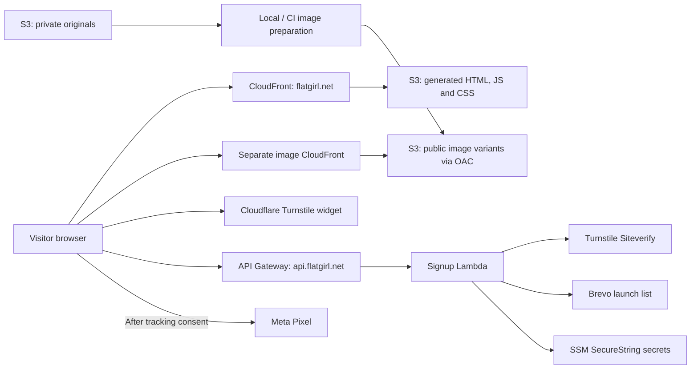

# Boring Flat Girl — implementation roadmap

Planning baseline: November 5, 2026. Milestones 1–2 are locally verified;
milestone 2 live rollout and milestones 3–6 are pending.
This document is the cross-session summary; detailed implementation plans belong
in their respective sessions. Milestone 2 included read-only AWS discovery;
no infrastructure has been changed by the agent.

Milestone 1 is now a minimal technical scaffold. Its
[detailed implementation plan](milestone-1-plan.md) was approved;
local implementation and checks are complete. See its handoff for results.
Nothing is deployed. Final landing-page work moves to milestone 6.

## Product and scope

**Boring Flat Girl** is a physical meme gift inspired by the childhood
Above the Influence commercials depicting Sarah as flat and boring after smoking
pot. The site should resemble a normal single-product page: prominent product
photography, a clear description, product details, and useful FAQs. Its primary
action is **“Notify me when it drops”**, replacing price and purchase controls.

The canonical domain is `https://flatgirl.net`; `www` redirects to it.
The first drop contains **500 units** on Black Friday. Assuming the upcoming
2026 holiday, the release date is **November 27, 2026**; the year and exact
release time/timezone still need confirmation. The user confirmed the promise
means **arrival before Christmas**, not merely dispatch before Christmas.
Eligible shipping destinations and any order cutoff remain to be specified.

Signing up requests a notification. It does not reserve one of the 500 units.
Do not cap the mailing list at 500 or imply that signup guarantees inventory.
Use only supplied product facts; dimensions, materials, included items, final
photography, and guarantee terms are not yet established.

Initial scope is one product landing page, with accessible privacy information
and tracking controls as needed. Excluded: checkout, payments, inventory
allocation, customer accounts, CMS, and a production Nuxt server. The Black
Friday sales destination and launch email campaign are separate work that must
be arranged before the drop; collecting addresses alone does not send a launch
notification or enable sales.

## Reference projects and reuse

| Reference | Reuse | Adaptation required |
| --- | --- | --- |
| `/Users/brucewilcoxon/BigNaturalsFoodCo/website/web/` | Nuxt static generation, TypeScript, Tailwind, accessible signup form and browser tests | Product-page layout, Flat Girl branding, metadata, copy, and image integration |
| Big Naturals `cloud/aws/` and `cloud/` runbooks | CDK, private S3/OAC/CloudFront, DNS/TLS, API/Lambda, SSM secrets, publication and verification scripts | Dedicated project configuration and resources; manual-first setup and permissions; separate beta and production hosting |
| Big Naturals `.github/workflows/deploy.yml` | Build artifact promotion, OIDC, gated deployments, serialization and public verification | Flat Girl trust, main-to-beta gate, release-to-production trigger, image preparation and live verification |
| `/Users/brucewilcoxon/Polis/2045-FishLamps/Site/` | Separate private originals and public image variants, immutable image CDN, local image mode, manifest/recipes and verification receipt | Reuse the image subsystem and separate beta/production hosting pattern; omit archive/reviews and Shopify migration |

Big Naturals' checked-in notes report successful local static hosting, but
signup recovery and GitHub integration verification remain pending. Treat that
code as a reference, not proof that its entire deployment works. Inspect current
source and dependency lockfiles when implementing; do not blindly copy versions,
account IDs, provider lists, resource names, secrets, or historical recovery steps.

FishLamps entry points: `cloud/IMAGES.md`, `web/ASSETS.md`,
`cloud/aws/lib/source-images-stack.ts`, `scripts/image_variants.py`,
`web/scripts/image-plan.mjs`, and `web/app/composables/useImageUrl.ts`.
Its documentation contains historical rollout notes; this session inspected
local code and documentation, not its current AWS deployment.

## Target architecture

Nuxt generates static HTML and assets into `web/.output/public`. Signup is the
only initial application backend. Meta Pixel executes in the browser, so it
does not require a Nuxt server, CDN worker, or Conversions API backend.

Use a dedicated Flat Girl image library and variants distribution. Keep originals
private and outside Git/public output. Generate responsive variants with
content-derived immutable URLs; use local prepared images during development.
Default to the image distribution's HTTPS hostname, as FishLamps does, unless
there is a concrete need for a custom image domain.

Public settings—API URL, Turnstile site key, image URLs, Pixel ID and feature
flags—are baked into the static build and require regeneration to change.
Brevo and Turnstile secrets remain server-side in SSM. A Pixel ID is public;
no Meta access token is needed for this browser-only integration.

## Milestones

Each milestone starts in a fresh session with a detailed plan. If planning and
implementation use separate sessions, save the detailed plan first. The estimates
below are rough hands-on planning/implementation time, excluding asset creation,
account setup, user review, DNS propagation, and external deployment delays.

### 1. Nuxt static hello world and image carousel — target about 20 minutes

**Outcome:** a plain, locally reviewable page with `<h1>Boring Flat Girl</h1>`,
a Sarah front/back carousel, and a successful static build ready for AWS hosting.

1. Establish `web/` with Nuxt, TypeScript, Tailwind, pinned dependencies/lockfile,
   local commands, and a small
   public configuration contract independent of deployed AWS resources.
2. Render only the heading and an accessible two-image carousel using the
   supplied Sarah front/back PNGs. Use plain HTML controls and minimal styling.
   No marketing copy, signup form, branding, or final product layout in this step.
3. Define the image manifest/recipes and URL abstraction using FishLamps as
   the architectural reference. Implement resizing in `tools/` with Python, uv,
   and Pillow. Separate `images/raw/` from `images/processed/`; generate 480px,
   960px, and native-resolution WebPs with a full-size link in the carousel.
   Keep raw images outside Git and site/CDN uploads. Production CDN support
   and separate private-source storage are completed in milestone 2.
4. Generate prerendered HTML, JS, CSS and prepared local images into
   `web/.output/public`. Document the static artifact contract for milestone 2;
   no deployed Nuxt server is required.
5. Check type safety, static generation, image preparation, mobile/desktop layout,
   keyboard controls, and a useful no-JavaScript fallback. Record exact commands
   and results in the detailed plan/handoff.

**Done when:** the generated site previews from an ordinary static file server,
shows the exact heading and both carousel images, and passes the local image
pipeline checks. Final content, styling, branding, imagery and social metadata
are explicitly deferred to milestone 6. No public production signup is implied.

### 2. AWS beta/production hosting, separate images, and local deployment — about 30 minutes local implementation target

**Status:** [detailed plan](milestone-2-plan.md) approved November 5, 2026.
Local implementation/checks are complete. AWS discovery was read-only;
[the rollout runbook](../cloud/DEPLOYMENT.md) remains user-run and unverified.

**Outcome:** the user can deploy and verify `beta.flatgirl.net` and `flatgirl.net`
from their machine, with independent site buckets/distributions and shared images.

1. Confirm AWS account/profile, region, domain registrar/DNS authority and
   hosted zone. Prepare Flat Girl access/site/image stacks and project config.
   Model separate beta and production stacks on Waller Creek High: beta at
   `beta.flatgirl.net`, protected with Basic Auth and noindex; production at
   `flatgirl.net`. Keep beta credentials out of Git, build artifacts, and logs.
   Shared certificates/images must not depend on the beta stack, so disabling
   beta cannot break production. Use private versioned S3, CloudFront OAC, HTTPS
   certificates and canonical redirects; preserve unrelated DNS records. Prefer `us-east-1` for parity with
   the reference and CloudFront certificate requirements.
2. Adapt the FishLamps source/variant workflow around milestone 1's Python/uv
   image tool and raw/processed separation: private originals, separate
   variant bucket/CDN, checksummed manifests/recipes, missing-only generation,
   conditional immutable uploads, and a verified build receipt. Preserve old
   variants for old pages and rollback. No transformation server is required.
3. Provide manual commands for infrastructure, source import, variant
   preparation/checking, site generation, publication and verification. Ensure
   variants exist before building/publishing HTML that references them. Publish
   hashed site assets before HTML, retain old assets, and invalidate entrypoints.
4. Adapt Big Naturals' routing allowlist for Flat Girl's actual public files,
   including icons, robots/sitemap files if included, and verification files.
   Images use their own CDN in production; unknown page redirects must never
   turn valid asset requests into HTML. Preserve campaign query parameters.
5. Validate synthesis and meaningful routing/publication/image tests; inspect
   real account permissions and prerequisites read-only. Review the complete
   resource lifecycle, including rollback, instead of fixing permissions one
   failing action at a time. The user executes rollout; verify public HTTPS,
   redirects, image delivery, cache headers and build contents afterward.

**Done when:** user-run deployments serve the expected build and images on
beta and production, beta authentication works, originals are inaccessible
publicly, a second unchanged image run performs no rendering/uploads, and rollback instructions are recorded.
Passing synthesis or IAM simulation alone is not deployment verification.

### 3. Turnstile and Brevo signup — roughly 4–8 hours

**Outcome:** visitors can request a launch notification successfully.

1. Confirm provider ownership and create a Flat Girl Turnstile widget and Brevo
   list. Keep business audiences isolated. Document a local, private secret-entry
   command that writes SSM parameters without printing values or needing GitHub.
2. Adapt the synchronous Big Naturals API/Lambda flow at
   `https://api.flatgirl.net/subscribe`: validate request size/email/consent,
   honeypot, expected origin and Turnstile hostname/action before contacting
   Brevo. Turnstile verification must occur server-side; CORS is not bot protection.
3. Preserve existing subscribers, unsubscribes and suppression. Use generic
   acceptance responses that do not reveal membership. Default to single opt-in
   as in Big Naturals; record consent source/time and text version through an
   agreed Brevo configuration without overwriting historical consent.
4. Add a minimal accessible form to the scaffold and connect submitting/success/error states, accessible feedback,
   token expiry/reset, retry and timeout handling. Define practical throttling
   for expected advertising bursts instead of inheriting Big Naturals' small
   shared limit blindly. Keep secrets and contact payloads out of logs/builds.
5. Test success, duplicate/suppressed contacts, invalid tokens, provider failures,
   retries and mobile behavior. After user-run deployment, submit a controlled
   address through the real widget and verify the correct Brevo list. Record
   provider failure visibility and the signup disable/recovery procedure.

**Done when:** a real valid signup reaches the correct list, rejected requests
do not write contacts, suppression is preserved, and failure/retry behavior works.
No welcome or launch email is sent by this backend. Brevo sender authentication,
unsubscribe handling and the eventual campaign need their own operational setup
before sending; do not configure or send campaigns implicitly.

### 4. Meta Pixel and consent — roughly 3–5 hours

**Outcome:** permitted browser events measure page visits and accepted signups.

1. Confirm the Flat Girl Meta business/dataset/Pixel ID, ownership and Events
   Manager access. Default tracking off locally and in tests; enable it explicitly
   for production. Recheck current Meta setup documentation in this session.
2. Add a small client-only Nuxt integration. Proposed baseline: load the Pixel
   only after marketing-tracking consent, with persistent accept/reject choices
   and a way to change them. Email subscription consent is separate; visitors
   can subscribe while declining tracking. Agree final privacy text and markets.
3. Send one `PageView` on consented page initialization and one `Lead` after
   the API accepts a signup request. Prevent duplicate events from double clicks,
   retries after UI success or component remounts; do not fire on CTA clicks,
   Turnstile completion or failed API responses. Do not backfill pre-consent
   actions or add a tracking `noscript` image that bypasses the chosen consent rule.
4. Define `Lead` as an accepted request, not a newly created contact: the reference
   API deliberately accepts duplicates and suppressed addresses generically.
   Report actual audience size from Brevo. Do not send email addresses or enable
   automatic advanced matching in this first integration; review automatic event
   settings so they do not duplicate the explicit events.
5. Test consent refusal/acceptance/withdrawal, reloads, API failures and blocked
   tracking scripts. Confirm events in Meta Test Events/Pixel Helper after a
   user-run rollout. Ensure security headers allow intended provider requests.

**Done when:** the intended events are visible in Meta, duplicates are controlled,
no Meta requests occur before consent under this baseline, and signup still works
when tracking is refused or blocked. Browser tracking cannot guarantee complete
measurement. Conversions API and server/browser event deduplication are deferred.

### 5. GitHub beta and release deployments — roughly 4–8 hours

**Outcome:** pushes to main deploy beta when enabled; publishing a production
release deploys its exact tagged commit to production.

1. Adapt Waller Creek High's separate site roles and deployment flags, with this
   trigger contract (its current workflow deploys both sites from main; do not
   copy that behavior):

   | Event | Destination | Condition |
   | --- | --- | --- |
   | Pull request | Checks only | No production credentials or writes |
   | Push to `main` | `beta.flatgirl.net` | Repository variable `DEV_DEPLOY_ENABLED == 'true'` |
   | GitHub `release: published` | `flatgirl.net` | Published, non-draft, non-prerelease release |

   Missing/false dev flag skips beta deployment. A main push never deploys
   production, and a tag push alone is not a release. Publishing an eligible
   release is the production deployment action.
2. Confirm repository identity and actual OIDC subjects. Use separate GitHub
   environments/roles for beta and production, restricted to the repository and
   intended environment. Validate event/ref separately: beta must be main;
   production must use the release tag's resolved SHA, reachable from main.
   Reject moved tags or stale runs. Keep IAM administration out of deployment roles.
3. Run frontend, Python/uv image, infrastructure, and applicable signup/Pixel
   checks on the exact commit. PRs use offline fixtures/test providers. Deployment
   runs prepare and verify images, build with environment-specific public settings,
   and publish that checked static artifact. Do not rebuild a newer main revision
   during release deployment. Beta tracking stays off; use test signup settings.
4. Bootstrap manually, then reuse local publication scripts in CI. Pin Actions,
   serialize deployments per destination, reject outdated beta runs, retain old
   assets and release artifacts for rollback, and preserve manual recovery. A
   disabled beta must not prevent release deployment or shared image preparation.
5. Verify one main push with the dev flag on, one with it off, and one published
   release. Confirm the deployed SHA and public HTTPS/images on each destination;
   verify forms/tracking where enabled. Check that draft/prerelease/tag-only events
   and ordinary main pushes cannot publish production. Record rollback commands.

**Done when:** gated beta and release-based production deployments have both
been observed and verified. Until then, the user deploys locally. Checkout and
Black Friday sales activation remain outside these six milestones.

### 6. Final landing-page content, style, branding, and images — roughly 4–8 hours

**Outcome:** a finished product landing page ready for launch review, replacing
the hello-world presentation. This is a launch requirement; it can begin earlier
once assets and product facts are ready, without renumbering milestones 2–5.

1. Confirm brand direction, final product images, product facts, release
   date/time, shipping destinations, and Christmas-arrival guarantee terms.
2. Build the responsive product layout: hero/gallery, description, product
   details, 500-unit drop announcement, FAQs, and “Notify me when it drops” CTA.
3. Integrate the working signup and consent controls from milestones 3–4 into
   the final layout, including privacy information and failure/retry states.
4. Replace pipeline test imagery as appropriate; finalize responsive recipes,
   alt text, favicon, canonical/social metadata, and social preview imagery.
5. Review mobile/desktop presentation, keyboard access, no-JavaScript content,
   performance, and live image/signup/tracking behavior through the established
   deployment process. Resolve missing content/assets before public promotion.

**Done when:** approved content and assets are deployed and verified, the offer
is accurate, signup and consent work in the final design, and no placeholder
branding or test-only presentation remains. Sales activation and sending the
launch campaign remain separate operational work.

## Decisions to resolve in the appropriate session

| Decision | Needed by | Current position |
| --- | --- | --- |
| Product photos, brand direction, dimensions/materials and included items | Milestone 6 | Supplied Sarah front/back images test milestone 1's pipeline; final assets/facts deferred |
| Release year/time, eligible destinations and arrival guarantee cutoff | Milestone 6 / before launch | 500 units; provisional November 27, 2026; arrival before Christmas confirmed |
| AWS account, domain DNS, operator access and dedicated image library | Milestone 2 | Discover/confirm; do not inherit other projects' resource identities |
| Brevo/Cloudflare ownership, list/widget, consent and notification sender | Milestone 3 | Dedicated Flat Girl audience/widget; single opt-in proposed |
| Meta ownership/Pixel ID, privacy markets, GitHub repository and trust | Milestones 4–5 | Browser Pixel with opt-in baseline; main-to-beta dev gate and release-to-production deployment |

## Session handoff protocol

1. Read this roadmap and current repository instructions/status. Review only
   the relevant parts of the reference projects; preserve any existing local work.
2. Save the selected milestone's detailed plan in `docs/milestone-N-plan.md`.
   Resolve implementation choices and blocking inputs there before implementation.
3. Keep local implementation/checks distinct from live rollout. Until automation
   is verified, provide concrete commands for the user to run locally. This
   roadmap is not an instruction to deploy, send emails, or change other projects.
4. At session end, update milestone status and a short handoff with changed files,
   exact checks/results, deployment evidence, unresolved decisions and next action.
   Mark local-ready and live-verified separately.
5. Begin the next session with: **“Read docs/IMPLEMENTATION-PLAN.md and the latest
   handoff. Make the detailed plan for milestone N. This session is planning only.”**

## Documentation references

Cloudflare documents that [Turnstile works without Cloudflare-proxied hosting](https://developers.cloudflare.com/turnstile/get-started/)
and requires [server-side validation of single-use, five-minute tokens](https://developers.cloudflare.com/turnstile/get-started/server-side-validation/).

GitHub documents [AWS OIDC authentication and repository/branch trust](https://docs.github.com/en/actions/how-tos/secure-your-work/security-harden-deployments/oidc-in-aws).
Use the subject format actually issued to this repository, including immutable
IDs where applicable; do not copy another repository's trust condition.

Meta implementation references for milestone 4:
[Pixel setup](https://developers.facebook.com/docs/meta-pixel/get-started/) and
[conversion events](https://developers.facebook.com/docs/meta-pixel/implementation/conversion-tracking/).
These pages returned HTTP 429 during this planning session; their current content
was not verified. Confirm exact initialization, consent and event behavior during
the detailed Meta plan. The browser integration above is the proposed design.
