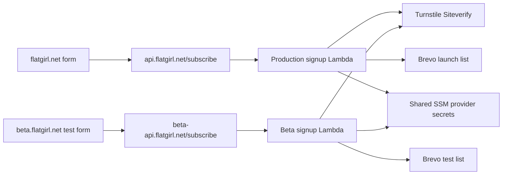

# Milestone 3 — Turnstile and Brevo signup

**Status: local implementation and checks complete November 5, 2026. Live rollout remains pending and user-run.**

Planning date: November 5, 2026. Milestones 1–2 are complete and live-verified.
This plan adds a working launch-notification form to the existing scaffold.

**Approved with the amendments below.** The implementation sequence, test
matrix, and rollout procedure follow. Estimates are 4–8 hours of implementation
and local checks, plus 1–2 hours of operator setup and live verification, excluding
account access, review, and DNS/certificate delays.

## 1. Decisions and scope

### Confirmed during planning

1. **Beta gets its own Brevo test list.** Production uses a separate Flat Girl
   launch list. Beta submissions must never add contacts to the production list.
2. **No consent checkbox.** Visitors submit their email to request the launch
   notification; a short blurb beside the button explains that purpose.
3. **No custom consent bookkeeping.** Do not add consent timestamps, wording
   versions, consent attributes, or a consent audit store. Brevo's ordinary contact
   metadata can remain as provided by Brevo.
4. **Implementation is approved.** Beta and production share the same Turnstile
   widget/secret and Brevo key. Beta list ID is **5**; production list ID is **4**.
5. **Brevo sends the welcome email.** Its automation owns that email; this
   application only adds eligible contacts to the selected list. Live infrastructure
   rollout remains user-run, following milestone 2's model.

### Implementation defaults

| Decision | Proposed default | Reason |
| --- | --- | --- |
| Signup flow | Single opt-in; welcome email managed by Brevo | No email delivery code in our backend |
| Environment separation | Separate API/Lambda configuration and lists; shared widget and provider secrets | Simple shared credentials with fixed destination lists |
| Brevo account | Use the confirmed Flat Girl account; both lists may live in it | Separate lists meet the requested test setup; see shared-contact limitation below |
| Form presentation | Minimal form below the current carousel; privacy details inline | Keeps final design in milestone 6 and avoids adding a new page/routing system |
| Failure handling | Synchronous request, clear error, manual retry with fresh verification | Keeps the service small; no queue or silent promise to deliver later |

**Target result:** a visitor enters an email, passes Turnstile, and receives a
generic acknowledgment after the backend has either saved the signup or safely
recognized an existing/suppressed contact. Signup does not reserve inventory, and
the mailing list is not capped at 500.

Excluded: application-side email delivery, campaign management, sender authentication changes, checkout,
inventory, customer accounts, Meta Pixel/tracking controls, GitHub deployment,
and final product-page design. No double-opt-in flow is introduced implicitly.

### Proposed form copy

| Element | Draft wording |
| --- | --- |
| Heading and button | “Notify me when it drops” |
| Blurb | “Submit your email to get the Boring Flat Girl launch notification. You can unsubscribe anytime.” |
| Inventory clarification | “Signing up does not reserve one of the 500 units.” |
| Acknowledgment | “Thanks—your notification request has been received.” |
| Inline privacy detail | “We use Brevo to manage the notification list and send our welcome email, and Cloudflare Turnstile to prevent spam.” |

Beta also displays “Test signup — this form uses our test list.” Use an inline
privacy anchor for any additional approved contact/privacy information. Confirm
the business contact address before public collection; do not invent one. Final
privacy wording and the eventual email's unsubscribe mechanism remain release
review items.

## 2. Existing foundation and reference findings

The current Nuxt app renders a heading and `SarahCarousel` from
`web/app/app.vue`. There is no signup component or public signup configuration.
The frontend is statically generated; API settings must be baked into each build.

Milestone 2 provides separate site hosting, shared images, protected beta,
environment-specific publisher roles, private release archives, and local Makefile
commands. Production remains intentionally noindex until later launch work.

| Finding | Consequence for milestone 3 |
| --- | --- |
| Big Naturals has a synchronous Lambda, Turnstile loader, form, and tests | Adapt those patterns; remove its checkbox/consent field and replace branding/configuration |
| Reference Lambda reads a contact before adding it to a list | Preserve the suppression checks; add explicit race and ambiguous-write handling |
| Reference API uses a small shared throttle | Derive limits from our provider quota and anticipated traffic |
| `StaticSynthesizer` rejects file assets and limits templates to 51,200 bytes | Use a small inline CommonJS Lambda initially; check both signup template sizes |
| Current AWS roles cover static hosting, not signup resources | Extend access, stack registries, and lifecycle permissions before rollout |

Reference files inspected under
`/Users/brucewilcoxon/BigNaturalsFoodCo/website/`:
`cloud/aws/lambda/signup.cjs`, `cloud/aws/lib/signup-stack.ts`,
`web/app/components/SignupForm.vue`, and `web/app/utils/turnstile.ts`.
They are implementation references, not evidence of a verified Flat Girl signup.

## 3. Architecture and configuration



### Environment contract

| Setting | Local/automated tests | Beta | Production |
| --- | --- | --- | --- |
| Allowed site origin | Local mock only | `https://beta.flatgirl.net` | `https://flatgirl.net` |
| API | Local fixture/mock | `https://beta-api.flatgirl.net/subscribe` | `https://api.flatgirl.net/subscribe` |
| Turnstile | Stub by default; official test keys for optional manual checks | Shared real widget | Same shared real widget |
| Brevo target | Mock responses; no writes | Flat Girl test list **5** | Flat Girl launch list **4** |
| Enabled by default | Off except explicit fixtures | Off until configured | Off until configured and reviewed |

Use two signup stacks, proposed identifiers `FlatGirlBetaSignup` and
`FlatGirlProductionSignup`. Each owns its regional API certificate, API Gateway
HTTP API, Lambda, logs, and API DNS record. Neither depends on the beta site
stack or the existing site certificate. Disabling beta hosting must not affect
production signup.

Only `POST /subscribe` and required CORS preflight are exposed. Disable the
default execute-api endpoint. Permit the exact environment origin, JSON content
type, and POST/OPTIONS. Browser requests use `credentials: 'omit'`; beta's Basic
Auth credentials must never be sent to the API. The beta API is publicly
reachable and protected by request checks, Turnstile, and throttling; the site
password does not protect that endpoint. Origin/CORS checks are not authentication.

Keep a validated, nonsecret environment configuration with distinct positive list
IDs, one shared widget site key, enabled flags, and throttle settings.
`cloud/signup.json` records lists 5/4 and public key `0x4AAAAAAF1pFARkZ1vCzj0T`,
with both environments initially disabled. The backend chooses the list from configuration; the
browser cannot select a list, provider account, or destination URL.

Public build settings are limited to signup enabled, endpoint, and Turnstile site
key. Extend `tools/deploy_site.py` to set and validate these explicitly, record
them in private release manifests, and reject production builds containing beta
endpoints or known test keys. Clear conflicting inherited signup environment
variables before generation. Continue accepting older archived manifests with
no signup settings as signup-disabled releases, so milestone 2 rollback works.

### Provider setup and secrets

1. Use the shared managed Turnstile widget with `flatgirl.net` and
   `beta.flatgirl.net` allowed. Enforce the exact environment hostname again in
   Lambda. Use the existing Brevo lists: beta **5**, production **4**.
2. Confirm the intended Brevo welcome automation and its list triggers before
   testing. Controlled test addresses may receive that welcome email. Confirm
   whether consent groups are enabled and how unsubscribe state is represented.
3. Store the two shared SSM SecureStrings at
   `/flat-girl/signup/turnstile-secret` and `/flat-girl/signup/brevo-api-key`.
   Both runtime roles read these same parameters; rotation affects both environments.
4. Add a private local prompt that writes the shared secrets once.
   Never put secret values in Make arguments, shell history, Git, CDK templates,
   generated output, or logs. Suppress raw SDK/CLI errors that could contain input.
5. Read secrets at runtime with a short bounded cache, proposed 60 seconds.
   Missing or unreadable secrets fail closed. Document rotation and cache expiry.

**Shared-contact limitation:** separate lists in one Brevo account do not create
independent contact databases. The same address can exist in both lists and have
shared attributes or global suppression. Use distinct controlled addresses for
beta tests and never unblock/delete a contact to reset a test. Complete contact
isolation would require a separate account; that is not the requested baseline.

## 4. Backend request and subscriber behavior

### Request contract

```json
{
  "email": "visitor@example.com",
  "turnstileToken": "token-from-widget",
  "website": ""
}
```

`website` is an empty honeypot. There is no consent boolean, text version,
timestamp, client-selected list, or analytics payload.

Process each request in this order:

1. Check the backend enabled flag, HTTP method, exact origin, and JSON content
   type. Bound the encoded and decoded body; use a 4 KiB decoded limit. Reject
   malformed JSON, non-object bodies, unknown fields, and invalid field types.
2. Trim the email, validate practical syntax/length, and require an empty
   honeypot and bounded token. Do not rewrite provider-specific addresses, strip
   plus tags, or merge addresses. Align browser/backend limits and test case handling.
3. Validate the token server-side with Turnstile. Require success, exact expected
   hostname, and action `subscribe`. A failed verification must make no Brevo
   calls. Tokens are single-use and expire after five minutes, so browser retries
   obtain a new token. [Cloudflare server validation](https://developers.cloudflare.com/turnstile/get-started/server-side-validation/)
4. Read the Brevo contact and apply the decision table below. Validate provider
   response shapes; a provider error must never be interpreted as “not found.”
5. Return only a generic acceptance or actionable category of failure. Log safe
   outcome codes and timings, never request bodies, email addresses, tokens,
   headers, contact URLs, or upstream response bodies.

### Brevo decision table

| Contact state | Action | Public result |
| --- | --- | --- |
| Not found | Create with email and selected list only; disable update/merge behavior | Accept after confirmed save |
| Already in target list | No contact update | Same acceptance |
| Globally email-blocklisted or unsubscribed from target list | No contact update or resubscription | Same acceptance |
| Existing contact, eligible, not in target list | Add only target list; preserve other memberships and attributes | Accept after confirmed save |
| Malformed state, unsupported consent-group setup, provider error | No speculative write; record safe failure category | Retryable service error |

Brevo exposes global email blocklisting, list unsubscribe information, and
optional consent-group state in its [contact details API](https://developers.brevo.com/reference/get-contact-info).
Confirm actual account behavior with controlled contacts before enabling signup.
If consent groups are enabled, define the applicable group and respect its
suppression; do not disable the feature or bypass an unsubscribe to make tests pass.

Use explicit creation versus existing-contact update. Never set blocklist flags
to false, change an existing email, remove other lists, or force-merge contacts.
Brevo documents that changing a blocklisted email can resubscribe it; that field
must be absent from updates. [Create contact](https://developers.brevo.com/reference/create-contact),
[update contact](https://developers.brevo.com/reference/update-contact)

### Duplicates, races, and uncertain results

1. If two requests both observe “not found,” a duplicate-create response triggers
   one bounded re-read and the same suppression decision. Do not fall back to an
   unconditional upsert.
2. If a write times out, return an error explaining that signup could not be
   confirmed. A fresh user retry re-reads the contact; a completed earlier write
   resolves as ordinary duplicate acceptance.
3. Do not automatically replay ambiguous contact writes or promise exactly-once
   processing. Retrying list membership is safe only after checking current state.
4. Verify that the selected list-add operation preserves a concurrent unsubscribe.
   A read followed by a write is not a transaction. If provider behavior cannot
   establish this, resolve the operation or narrow existing-contact handling
   before rollout; do not claim that the initial read eliminates the race.

Generic responses conceal membership in response content/status, but do not
claim to remove every timing side channel. No welcome or launch email is sent
by this handler. The user's Brevo welcome automation is expected to send email.

### Responses and time budgets

| Outcome | Response / UI behavior |
| --- | --- |
| Saved, existing member, or suppressed | `200 { "accepted": true }`; generic acknowledgment |
| Invalid request / verification | `400` or `403`; correct input or retry verification |
| Wrong method or content type | `405` or `415` where handled; gateway may reject unmatched routes |
| Throttled | `429`; wait, then manually retry with a fresh token |
| Disabled, provider failure, or uncertain save | `503`; keep email in the form and offer retry |

Set `Cache-Control: no-store` on handler responses. Handle gateway-generated
non-JSON errors in the browser as well. Proposed budgets: 12 seconds total for
handler I/O, 15-second Lambda timeout, 18-second browser timeout. Use abortable
requests and bounded AWS SDK attempts. No hidden background submission continues
from the browser after the form is unmounted.

## 5. Form behavior and accessibility

Build a focused `SignupForm.vue` plus a small client-only Turnstile loader.
Keep the heading, image carousel, image delivery, and no-JavaScript gallery intact.

| State | Visitor experience |
| --- | --- |
| Signup disabled | Clear “Notifications aren't available yet” message; no provider scripts or API call |
| Ready / verifying | Labeled email field, explanatory blurb, widget status, submit button |
| Submitting | One in-flight request, visible progress, duplicate submissions disabled |
| Accepted | Generic acknowledgment announced and focused; email cleared; widget removed |
| Failure / expired verification | Email preserved, accessible message, verification retry and submission retry |

Use an email input with autocomplete, suitable mobile keyboard, visible focus,
and associated error text. Keep the honeypot outside keyboard and assistive
technology navigation. No checkbox or localStorage/cookie containing the email.
With JavaScript disabled, explain that signup needs JavaScript; do not expose an
unverified native form POST.

Load the official Turnstile script once after mount when signup is enabled.
Handle blocked scripts, script timeouts, expiry, interactive challenge timeouts,
late callbacks, and component teardown. Clear consumed tokens after submission
and ignore callbacks from an older widget attempt. Use the documented
[widget callbacks and refresh options](https://developers.cloudflare.com/turnstile/get-started/client-side-rendering/widget-configurations/).

Check actual response security headers and browser behavior. If a CSP is used,
allow the required Turnstile script/frame origins and the selected API connection
without breaking Nuxt hydration or images. Follow the
[Turnstile CSP guidance](https://developers.cloudflare.com/turnstile/reference/content-security-policy/).
Do not add Meta scripts or a tracking-consent banner in this milestone.

## 6. Capacity, observability, and recovery

### Initial capacity proposal

Brevo currently documents a general contacts quota of 10 requests/second and
36,000/hour. Verify the account's actual tier, response limit headers, and other
integrations before choosing production limits. [Brevo rate limits](https://developers.brevo.com/docs/api-limits)

Provisional API settings are production **3 submissions/second, burst 5** and
beta **1 submission/second, burst 2**. A normal new signup consumes a contact
read and write, so together these can consume about 8 contact operations/second
before races or other applications. These are starting settings, not guaranteed
capacity. Shared-account activity may require lowering them; advertising demand
may require a higher Brevo tier or a separately reviewed queue design.

API Gateway throttles are best-effort targets, not hard ceilings or per-visitor
limits. Provider throttling can still occur; return a retryable error and monitor
it. [AWS HTTP API throttling](https://docs.aws.amazon.com/apigateway/latest/developerguide/http-api-throttling.html)

Load-test against mocked providers first. Do not run bulk live signups or disable
Turnstile on a public endpoint for testing. Choose any Lambda concurrency cap
from measured duration, arrival rate, and available account quota; do not infer a
requests-per-second limit directly from concurrency.

### Visibility and operating procedure

1. Emit structured outcomes such as `accepted`, `validation_rejected`,
   `verification_rejected`, `secrets_failed`, `turnstile_failed`, and
   `brevo_failed`, with environment, stage duration, and an AWS request ID.
   Use aggregate counts, without address hashes or contact identifiers.
2. Provision per-environment logs with proposed 30-day retention, API/Lambda
   metrics, and alarms for provider failures and Lambda errors/throttles. Include handled `503` outcomes: they do not necessarily increment
   Lambda's native error metric.
3. Propose an alert after three provider/service failures in five minutes, then
   tune against test results. Confirm the operator's alert destination before
   wiring notifications. Alarms without a recipient are not an attended alert.
4. Provide a backend disable command through reviewed stack configuration. It
   returns `503` before provider access even for cached pages. A separate site
   rebuild can display the disabled form. Do not delete lists, keys, or contacts
   as a shutdown mechanism.
5. Recover by inspecting safe failure metrics, fixing provider configuration or
   rotating secrets, verifying on beta, then re-enabling production and submitting
   one controlled production address. Roll back frontend artifacts through the
   existing publisher; restore backend configuration/code separately.

Frontend rollback does not undo contacts already added. Keep the request contract
compatible with cached and archived milestone 3 pages. Document that no retry
queue exists: a failed request may require the visitor to retry, and an ambiguous
write may already have reached Brevo.

## 7. Implementation sequence

Each step ends with a reviewable checkpoint; local-ready and live-verified are
separate statuses.

1. **Configuration and provider contract — 30–60 minutes.** Define validated
   environment settings, public build settings, list separation, suppression
   behavior, and secret names. Confirm provider access, account features,
   automations, initial traffic assumptions, and final blurb. Checkpoint: example
   configs synthesize disabled; no real identifiers are copied from references.
2. **AWS access and signup stacks — 60–90 minutes.** Add both stacks and runtime
   roles; extend TypeScript/Python stack registries and operator tooling. Add API
   certificates/DNS, logs, alarms, explicit CORS, and scoped SSM access.
   Checkpoint: offline synthesis/assertions pass and the complete IAM diff is
   reviewable, including update, rollback, secret rotation, and disable operations.
3. **Handler and private operator commands — 60–120 minutes.** Implement the
   validated request flow, Turnstile verification, contact decisions, timeouts,
   secret loading, safe logging, and secret/preflight/disable commands.
   Checkpoint: deterministic handler and operator tests pass with fake providers.
4. **Form and build integration — 60–120 minutes.** Add the accessible form,
   widget lifecycle, failure states, copy, and explicit environment build settings.
   Checkpoint: generated static site works locally with mocked signup at mobile
   and desktop sizes; disabled builds make no provider requests.
5. **Regression checks and handoff — 30–90 minutes.** Run the matrix below,
   document exact user-run deployment/recovery commands, and review the diff.
   Checkpoint: local-ready record includes commands/results and remaining live
   checks; production remains unchanged until user-run rollout.

### Permission design

Create the two Lambda runtime roles in the administrator-managed access stack.
Each may read the two shared SSM parameters and write only its own logs, plus any
explicit metric permission required by the chosen logging approach. It cannot
publish sites or change DNS. Sharing provider keys between environments is intentional.

Extend the CloudFormation execution role for the named signup functions,
API Gateway resources, logs/metrics/alarms, certificates, and exact API DNS names
and validation records. Permit passing only the designated runtime roles to
Lambda. Keep IAM administration in the access stack. Document API Gateway/ACM
operations that cannot be tightly scoped before generated resource IDs exist.

Give the operator bounded secret-write and status/diagnostic access. Site
publisher roles must not gain secret access. Confirm SSM encryption/key-policy
requirements for the chosen key; a dedicated KMS key is unnecessary unless
account policy requires one. Check Brevo IP restrictions: this design uses Lambda
without a VPC or fixed outbound IP. If fixed egress is required, revise the
architecture and estimate before implementation rather than disabling an account
security control implicitly.

### Planned file changes

| Area | Files | Purpose |
| --- | --- | --- |
| Frontend | `web/app/components/SignupForm.vue`, `web/app/utils/turnstile.ts`, `web/app/app.vue`, `web/nuxt.config.ts`, browser tests | Form, widget, public settings, offline UI verification |
| Backend/infrastructure | `cloud/aws/lambda/signup.cjs`, new signup stack/config modules and tests; existing `bin/app.ts`, `lib/config.ts`, `lib/access.ts` | API behavior, resource isolation, permissions, synthesis |
| Operator tools | `Makefile`, new `tools/signup.py`, `tools/aws_common.py`, `tools/cloud.py`, focused tests | Private secrets, provider/config preflight, status, enable/disable, stack registration |
| Publication | `tools/deploy_site.py`, deployment tests, example signup configuration and ignore rules | Explicit build settings, environment rejection, manifest compatibility |
| Documentation | `cloud/SIGNUP.md`, `cloud/ACCESS.md`, `cloud/DEPLOYMENT.md`, README and milestone plans | Provider setup, commands, rollout, failure recovery, observed evidence |

## 8. Verification matrix

| Area | Required local evidence | Required live evidence |
| --- | --- | --- |
| Request validation | Size/base64 boundaries, malformed JSON/types, invalid email, honeypot, origin/method/content-type rejection; no Brevo calls on rejection | Invalid request produces no contact; CORS/preflight works from actual sites |
| Turnstile | Failure, expiry/replay, wrong hostname/action, timeout, malformed provider result; fresh-token retry | Real widget works on both site hostnames; invalid token cannot write contacts |
| Contact behavior | New, existing target member, existing other-list contact, global/list suppression, consent-group state, malformed lookup, create race, read/write timeouts and 429 | Controlled new/duplicate/suppressed addresses preserve expected memberships and suppression |
| Form lifecycle | No checkbox; blurb visible; keyboard/mobile behavior; script failure/retry, double submit, stale callbacks, unmount, no-JS and disabled modes | Actual beta and production browsers complete signup; blocked widget shows useful recovery |
| Infrastructure/build/operations | Distinct lists/roles/paths/origins, no secrets in artifacts/logs, inline template size, alert on handled failures, old manifest rollback support | Correct list per environment; safe logs and alarm visibility; disable/re-enable and secret rotation demonstrated |

Ordinary tests must not need AWS credentials or call Cloudflare/Brevo. Use mocked
HTTP and browser fixtures; official Turnstile test keys are suitable for optional
integration checks but must never enable production writes.
[Cloudflare testing guidance](https://developers.cloudflare.com/turnstile/troubleshooting/testing/)

Planned regression commands retain the existing interfaces:

```sh
npm run check --prefix cloud/aws
npm run typecheck --prefix web
npm run test:images --prefix web
npm run generate --prefix web
npm run test:e2e --prefix web
npm run test:cdn --prefix web
```

Integrate backend tests into the infrastructure package's check command and
operator tests into Python discovery. Extend browser fixture setup so both
enabled and disabled signup builds are covered. Record exact commands and test
counts in the implementation handoff below; live provider checks remain separate.

## 9. User-run rollout and completion

**The signup commands below are implemented locally.** See
[cloud/SIGNUP.md](../cloud/SIGNUP.md) for the rollout sequence.

| Purpose | Proposed command | Effect |
| --- | --- | --- |
| Inspect signup prerequisites | `make signup-preflight PROFILE=flat-girl SITE_ENV=beta` | Read-only AWS/provider checks; redact contact/secret data |
| Enter or rotate secrets | `make signup-secrets PROFILE=flat-girl` | Private prompts; writes shared SSM parameters; optional `KEY=turnstile` or `KEY=brevo` |
| Inspect service health/configuration | `make signup-status PROFILE=flat-girl SITE_ENV=beta` | Safe read-only summary; no contact dump |
| Preview backend enable/disable | `make signup-enabled PROFILE=flat-girl SITE_ENV=beta ENABLED=false DRY_RUN=1` | Local diff only; no AWS/provider write |
| Apply backend enable/disable | `make signup-enabled PROFILE=flat-girl SITE_ENV=beta ENABLED=false` | Selected signup stack update; use `true` to restore |

Preflight reports missing parameters without inventing values. Provider checks
that need secrets read them only inside the tool and never print them. No preflight
or dry-run may add a contact, send mail, or change an account setting.

1. **Prepare providers and access.** Confirm the shared widget, lists 5/4, and
   intended welcome automation. Review the access diff; the administrator applies the updated
   access stack using the established `BOOTSTRAP=1` workflow. Enter shared secrets
   privately and verify safe prerequisites. Do not alter existing mail DNS records.
2. **Deploy beta backend and frontend.** Review `STACK=signup-beta`, provision
   it disabled, then enable it when configuration passes. Build/publish/verify
   beta with the existing `SITE_ENV=beta` publisher commands. Check that no beta
   password is forwarded across origins.
3. **Verify beta and recovery.** Submit controlled test addresses through the
   real widget; inspect the test list privately. Exercise duplicates, suppression,
   disable/re-enable, and secret rotation. Confirm provider failure visibility
   using controlled beta configuration or mocks, without damaging real contacts.
4. **Deploy production.** Repeat for `STACK=signup-production` with list 4 and
   the same shared secrets/widget, review the diff, and publish an independently built clean
   production artifact. Submit one controlled production address; verify it reaches
   only the launch list and that duplicate submission preserves state. Demonstrate
   backend disable/re-enable before public promotion and confirm recovery.
5. **Record evidence.** Save release/stack identities, timestamps, commands,
   test results, safe operational observations, and remaining issues. Keep email
   addresses, keys, contact exports, and unredacted provider screenshots out of
   the repository. Mark milestone 3 complete only after live checks pass.

### Done when

1. A real production signup reaches the correct launch list and the form is
   accessible on mobile/desktop; beta reaches its separate test list.
2. Rejected verification/validation never writes contacts; existing subscribers,
   unrelated memberships, and applicable suppression are preserved.
3. Retry, duplicate, timeout, disabled, and provider-failure behavior is verified
   without revealing membership or exposing secrets/contact payloads.
4. The user has working secret-rotation, health, backend-disable, recovery, and
   frontend rollback instructions, with observed evidence clearly distinguished
   from local tests.
5. The simple form matches the approved scope: explanatory blurb, no checkbox,
   no custom consent history, and no application-side email delivery. Brevo manages
   the welcome email; campaign changes remain separate.

## Planning handoff

Inspected the existing scaffold, access/stacks, publication tools, roadmap,
milestone 2 completion record, and relevant Big Naturals source. Consulted
official Cloudflare, Brevo, and AWS documentation linked above. The planning phase made no live account changes. Implementation was subsequently
approved with the shared-key, list-ID, and Brevo-welcome amendments above.
The implementation handoff below records the final checks and rollout status.

Remaining live inputs: enter shared provider secrets privately; confirm widget
hostnames, intended welcome automation, actual quotas, and account suppression
behavior. CloudWatch alarms have no notification destination until one is configured.
List IDs, public key, and the simple form are settled.

**Next action:** start the access review in [cloud/SIGNUP.md](../cloud/SIGNUP.md).


## Implementation handoff — November 5, 2026

**Local-ready; not live-verified.** Implemented the minimal form, Turnstile
lifecycle, synchronous signup handler, two API stacks, shared-secret access,
private entry/preflight/status/enable commands, and validated publication settings.
The user's shared public key is recorded in `cloud/signup.json`; beta list **5**
and production list **4** are fixed. Both enabled flags remain false.

The user approved development with these amendments: share the widget and both
provider secrets, use the supplied existing lists, and allow the intended
Brevo-managed welcome email. The application does not configure or send it.
The earlier draft's separate keys and inactive-automation proposals are superseded.

| Verification | Observed result |
| --- | --- |
| `npm run check --prefix cloud/aws` | Typecheck, 15 handler/infrastructure tests, and seven-stack offline example synthesis passed |
| `npm run synth --prefix cloud/aws` | Seven stacks synthesized for the local project configuration; access template 27,712 bytes, beta signup 16,964, production signup 17,145, all below 51,200 |
| `npm run typecheck --prefix web` | Passed, including form and browser test types |
| `npm run test:images --prefix web` | 16 Python image/publication/signup-tool tests passed |
| `npm run test:signup --prefix web` | Enabled static build and 13 browser tests passed; disabled-only case intentionally skipped; helper restored disabled output |
| `npm run test:e2e --prefix web` | 5 disabled-form/carousel browser tests passed; enabled-only cases intentionally skipped |
| `npm run test:cdn --prefix web` | Isolated typecheck/build and 5 browser tests passed with no raw/processed images in the fixture checkout |
| `git diff --check` and Make command previews | Whitespace and signup command dispatch checked; no AWS calls from previews |

Tests used `UV_CACHE_DIR=/private/tmp/flat-girl-uv-cache` because the sandbox
could not write the default uv cache. Browser checks ran with permission to bind
the local preview socket and launch installed Chrome. All provider responses in
these tests were mocked; no live address was submitted.

Implementation details relevant to rollout:

1. Runtime roles share the two exact SSM paths; publisher roles have no secret
   access. API/list/origin settings remain separate. The existing no-asset CDK
   workflow packages the handler inline without adding dependencies.
2. Existing contacts receive only a list-membership update after suppression
   checks. Duplicate-create races re-read state. There is no unconditional upsert,
   email replacement, automatic unsuppression, queue, or ambiguous-write replay.
3. Public build settings are set explicitly and archived; conflicting inherited
   signup environment variables are removed. Milestone 2 release manifests remain
   valid without signup metadata.
4. Three console alarms per environment cover handled provider failures, Lambda
   errors, and Lambda throttles. There is no notification recipient or added
   alerting service. Durations are logged for investigation.
5. Backend enable/disable uses the selected CloudFormation stack and updates the
   local public config. Provider key rotation is shared and has a 60-second cache
   window. The runbook separates backend recovery from frontend artifact rollback.

No AWS/provider changes, secret reads, emails, commits, or pushes were performed.
The outstanding work is the user-run access/backend/site rollout, private secret
entry, and real widget/list/suppression/welcome/recovery checks in
[cloud/SIGNUP.md](../cloud/SIGNUP.md). Provider list-update behavior during a
concurrent unsubscribe and account-specific consent-group configuration are not
proven by mocks; verify those before public collection. Do not mark the overall
milestone complete until the live acceptance criteria pass.

### Initial rollout correction — November 5, 2026

The user's beta signup deployment failed creating the API Stage because the
execution role lacked `apigateway:TagResource`. Read-only inspection confirmed
`ROLLBACK_COMPLETE` and one retained, unused log group (zero streams/bytes).
The agent checked the live AWS resource schemas for API, Stage, DomainName,
ApiMapping, Integration, and Route; corrected Stage tagging/untagging and scoped
domain certificate attachment/removal permissions; and added regression assertions.
Signup logs now use `RetainExceptOnCreate` while retaining established logs on
update/delete. The [signup runbook](../cloud/SIGNUP.md#recover-the-initial-beta-tagging-failure)
contains the concrete user-run access update and one-time cleanup/retry commands.
No recovery writes were executed by the agent. Live rollout remains pending.
