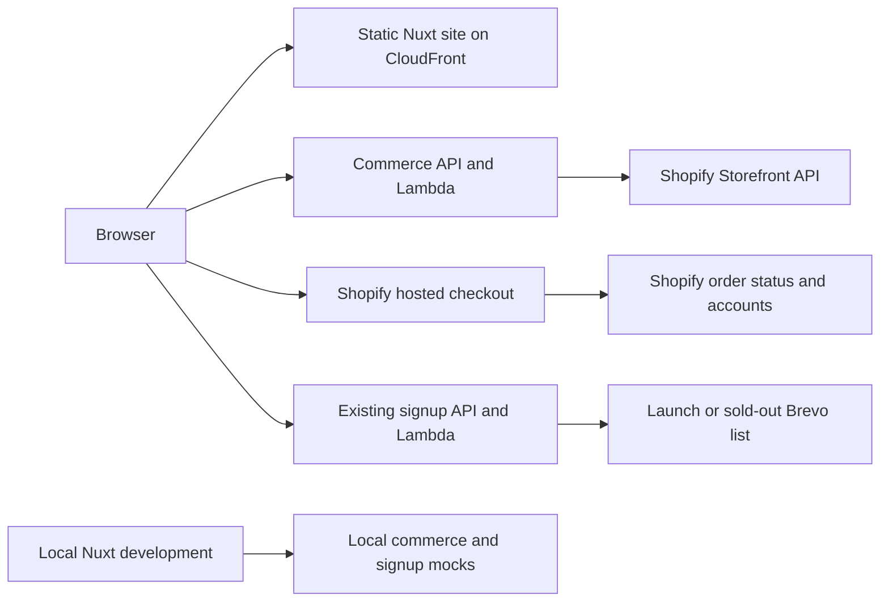

# Shopify integration — session plan

**Updated:** November 16, 2026. **Next:** Session 1, local storefront UI.

This is the current ecommerce plan. The user requested frontend work first so
the design and purchase states can be iterated locally, followed by separate
Codex sessions for the remaining integration work. This planning session does
not implement the storefront or deploy anything.

## Start a fresh session

Read this document's current state, decisions, contracts, and the selected
session. Read that session's listed source files and applicable AGENTS.md
instructions. Use `git status` before editing; preserve existing changes.
Do not reread every historical milestone plan or redo the completed API proof.
Work on the selected session only, update its handoff, and leave a specific
next action. If a session needs splitting, record the boundary and remaining work.

Copy this for the next session:

> Implement Session 1 in docs/plans/shopify-integration-plan.md. Start with the
> local storefront UI and deterministic commerce mocks. Preserve the existing
> minimal Nuxt design and static hosting. Run the relevant local checks and
> update the session handoff. Do not connect live services or deploy.

For subsequent sessions, replace the session number and use its scope below.
Plans describe intended work; they are not evidence that it is deployed.

## Current state and evidence

| Item | Recorded state |
| --- | --- |
| Public site | `flatgirl.net`, existing waitlist, statically generated Nuxt/Vue and plain CSS on S3/CloudFront |
| Beta | `beta.flatgirl.net`, Basic Auth and noindex; independent static publication |
| Shopify API host | `tepwtx-zw.myshopify.com`; retain this working API identifier |
| Current customer-facing Shopify host | `flatgirl.myshopify.com`; accepted by the smoke test |
| Product / variant | `gid://shopify/Product/15491665297684` / `gid://shopify/ProductVariant/68124854681876` |
| Product facts observed in proof | USD 60.00, available for sale; Shopify is the price/availability authority |
| API version | Smoke test pins Storefront API `2026-10`; recheck support when implementing |
| API proof | Owner confirmed test purchase through confirmation email on November 16 |
| Order-status verification | Access from the email link in a fresh/private browser is not yet explicitly confirmed |
| Payments | Owner enabled test mode; recheck actual setting before each live test and launch |
| Local commands | `make shopify-check` reads product; `make shopify-test` creates one-unit cart and opens checkout; private token prompt, no saved credential |
| Brevo | Launch lists beta **5**, production **4**; sold-out list IDs not created/recorded |
| Meta | Existing edge `ViewContent` and signup `Lead` CAPI pipeline; no implemented purchase sender in that pipeline |
| Domains | `checkout.flatgirl.net`, `shopify.flatgirl.net`, and separate `account.flatgirl.net` are proposals, not completed configuration |

The password/redirect-theme problem occurred during the first proof and was
subsequently overcome by the owner. Its exact resolution is not recorded. Preserve
the working Shopify setup; do not repeat historical password workarounds merely
because they appear in [SHOPIFY.md](../SHOPIFY.md).

At plan creation, Makefile/docs changes and the Shopify proof script/tests are
uncommitted. Treat them as existing work, not generated files to discard.

## Decisions and scope

1. Keep Nuxt, Vue, plain CSS, the image pipeline, carousel, photo viewer, and
   static AWS hosting. Use direct Storefront API calls from a small AWS backend.
   No Hydrogen migration or production Nuxt server is needed for this release.
2. Sell one configured blanket variant through quantity selection and **Buy now**.
   Shopify owns pricing, stock enforcement, checkout, payments, orders, order
   emails, and hosted order/account pages. No local cart drawer, customer login,
   Customer Account API, or payment collection in our frontend.
3. Keep Brevo launch subscriptions and add a distinct sold-out audience. The
   owner manually sends restock/next-drop campaigns. No Brevo product sync,
   restock automation, Shopify waitlist app, or new email engine.
4. Build and review locally, integrate on beta, then deliberately launch
   production. Preserve the waitlist path and archived production artifact.
   Use the existing store for the current prelaunch proof; do not require a
   second Shopify store to begin local work.
5. Keep provider-specific code small and isolated. A future Stripe/custom
   commerce replacement is out of scope; do not design a generalized commerce
   framework now. TikTok Shop is a separate sales-channel task, not a dependency
   for finishing the website.

The MSCHF reference guides a product/drop-focused presentation: strong imagery,
little navigation, a direct action, and an intentional sold-out page. It is not
a requirement to copy a site or add animation, product grids, or extra libraries.

## Session sequence

Estimates are hands-on engineering time, not promises of one uninterrupted agent
turn. They exclude account onboarding, design feedback, DNS propagation, and
operator availability. If a section grows, split it rather than expand its scope.

### Build

| Session | Outcome | Dependencies | Estimate | Status |
| --- | --- | --- | --- | --- |
| 1 | Local purchase UI and deterministic mocks | Existing frontend | 2–4 hours | **Next** |
| 2 | Commerce backend and deployment tooling, checked locally | Session 1 contract | 3–5 hours | Not started |
| 3 | Sold-out Brevo signup and local integration | Session 1 signup contract | 2–3 hours | Not started |

### Verify and launch

| Session | Outcome | Dependencies | Estimate | Status |
| --- | --- | --- | --- | --- |
| 4 | Beta deployment and full purchase/signup rehearsal | 1–3 | 2–4 hours | Not started |
| 5 | Branded checkout/accounts and return navigation | Working beta; domain decision | 1–2 hours plus DNS | Not started |
| 6 | Verified Meta and TikTok website purchase attribution | Working checkout, preferably final domains | 2–4 hours | Not started |
| 7 | Production launch and rollback rehearsal | 4–6; explicit deferrals recorded | 1–2 hours | Not started |

Optional Session 8: TikTok Shop onboarding, inventory/order synchronization, and
fulfillment rehearsal, about 2–4 hours plus platform review. It can proceed once
product policies and fulfillment timing are settled, independently of launch.

## Shared architecture and contracts

These are proposed interfaces for Session 1 to establish. Once implemented,
record the actual types here so later sessions implement the same contract.
Endpoint names below are planned and do not exist yet.



### Rendering and environment boundaries

Keep the product story and image HTML prerendered. Fetch commerce state after
rendering; do not block the page shell or photos on Shopify. Make the purchase
area stable in size during loading. Avoid a hardcoded second price in prose when
commerce is active. Display a useful no-JavaScript message; never render a fake
working checkout link in a static fallback.

Use an explicit public storefront mode: `waitlist` (default for generated builds)
or `commerce`. Session 1 can default **development only** to mocked commerce.
Use a narrow service/composable boundary so mocks and live endpoints share types
and components. Local scenario selection must have no effect in published builds.

Keep `nitro.preset = 'static'`. Nuxt `server/api` endpoints are local development
mocks, not deployed services. Guard them with `import.meta.dev`. The publisher
must reject mock endpoint/settings, localhost handoffs, and fixture data in live
commerce artifacts. Never put the private token in public runtime config.

### Product and checkout API

Planned production paths are `GET /commerce/product` and
`POST /commerce/checkout` on the environment's existing API hostname. Local
equivalents use `/api/commerce/product` and `/api/commerce/checkout`.

Proposed product response:

```json
{
  "schemaVersion": 1,
  "salesOpen": true,
  "product": {
    "id": "gid://shopify/Product/15491665297684",
    "variantId": "gid://shopify/ProductVariant/68124854681876",
    "title": "Boring Flat Girl Plush Blanket",
    "availableForSale": true,
    "price": { "amount": "60.00", "currencyCode": "USD" }
  },
  "quantityLimit": 5
}
```

`quantityLimit: 5` is a development fixture, not an approved business limit.
Confirm the live cap before Session 4. Use decimal strings or minor units for
money, not floating-point price comparisons. The initial market is US/USD as
used in the proof; shipping destinations must be confirmed before launch.

Proposed checkout request:

```json
{
  "quantity": 1,
  "expectedUnitPrice": { "amount": "60.00", "currencyCode": "USD" }
}
```

The backend selects the configured product/variant and obtains authoritative
pricing from Shopify. The expected price only detects a stale display; it never
sets the price charged. On success return `201` with `{ "checkoutUrl": "..." }`.
Do not return/store the cart secret in public pages, logs, or analytics.

| Response | UI behavior |
| --- | --- |
| `400 INVALID_REQUEST` | Explain invalid quantity; preserve editable selection |
| `409 SOLD_OUT` / `QUANTITY_UNAVAILABLE` | Refresh availability; show sold-out signup or permit a lower quantity |
| `409 PRICE_CHANGED` | Refresh price, announce change, require another Buy now click |
| `403 SALES_CLOSED` | Show launch-notification state; no checkout handoff |
| `429 RATE_LIMITED` / `503 UNAVAILABLE` | Retryable message; never label an outage as sold out |

Use a stable error envelope such as `{ "error": { "code": "SOLD_OUT" } }`.
Inspect HTTP and GraphQL errors, cart warnings, final line variant/quantity, and
cost before returning checkout. Keep warnings conservative until explicitly
classified. Reject unsafe checkout URL schemes, credentials, ports, and hosts;
use the exact configured allowlist, including the two current myshopify hosts.

Disable repeated submission while a request is pending. Do not automatically
retry `cartCreate` after a timeout: the upstream operation may have succeeded.
A manual retry may create another abandoned cart, not a second order. Checkout
still performs the final stock and shipping checks; a cart is not a reservation.

### Frontend states

| State | Visible behavior |
| --- | --- |
| Waitlist / sales closed | Current launch form and accurate prelaunch copy |
| Loading | Photos/story visible; neutral purchase-area loading state |
| Available | Formatted Shopify price, quantity, Buy now |
| Submitting | Pending feedback, disabled duplicate submission, retained quantity |
| Sold out | Explicit sold-out message and separate sold-out signup copy |
| Request failed | Inline retry, no false sold-out claim or lost form input |
| Price or stock changed on Buy | Refresh/announce change before another action |

No invented countdown, stock scarcity count, or promised restock date. Confirm
whether sold-out copy promises only a possible restock or includes future drops.

### Signup compatibility

Extend `/subscribe` with a bounded `purpose: "launch" | "sold_out"` field.
Missing purpose means `launch` so old cached pages keep working. Existing fields
remain `email`, `turnstileToken`, and the empty honeypot `website`. Keep the same
public acknowledgment for new, existing, or suppressed contacts.

The currently deployed handler rejects extra request fields. Until the Session 3
backend is deployed, launch submissions must keep omitting `purpose`; only the
local mock may accept it during Session 1. Do not enable real sold-out submissions
until the matching backend and list mapping exist. This keeps a routine waitlist
build from breaking the existing signup service between sessions.

Resolve purpose to list ID on the server; never accept an arbitrary Brevo list
ID from the browser. Existing launch lists remain beta 5 and production 4.
New beta and production sold-out list IDs must be explicitly configured.
Reusing one Brevo account still shares contacts and global suppression.

An eligible launch-list member can join the sold-out list without recreating
their contact. Preserve global/list suppression, unrelated memberships, consent
group handling, and duplicate protections. Do not subscribe a buyer simply
because they checked out, or send the launch welcome workflow to sold-out signups.

## Session 1 — local storefront UI first

**Outcome:** the user can iterate on the actual product page and every purchase
state locally, without Shopify credentials, AWS, Brevo writes, or outbound tracking.

**Read:** `web/nuxt.config.ts`, `web/app/app.vue`,
`web/app/components/SignupForm.vue`, `web/app/assets/css/main.css`,
`web/server/api/subscribe.post.ts`, `web/playwright.dev.config.ts`,
`web/tests/page.spec.ts`, `web/tests/dev/signup.spec.ts`, `docs/DEVELOPMENT.md`.

**Implement:**

1. Add small typed commerce contracts, a composable/service, and a purchase
   component. Keep UI markup independent of Shopify GraphQL. Preserve the current
   photography, responsive layout, typography, carousel, and photo viewer.
2. Implement quantity/price/Buy now, loading, submitting, retry, sold-out, and
   sales-closed states. Reuse SignupForm with explicit purpose/copy inputs and
   launch defaults. Extend only its local mock in this session.
3. Add deterministic development fixtures for available, sold out, sales closed,
   delayed/error responses, and stock/price changes during purchase. Choose a
   documented dev-only environment setting or query switch. Add no developer
   controls to the customer UI. Successful mock checkout must visibly simulate
   a handoff on localhost, never open Shopify or suggest a real order was placed.
4. Preserve default generated waitlist behavior. Add narrow tests around state
   transitions, quantity bounds, malformed responses, double clicks, signup
   purpose, and retry. Test both dev mode and generated static markup; browser
   interception can provide mocked commerce responses to static previews.
5. Document exact local commands/scenarios and the implemented contract. Record
   mobile/desktop review and baseline versus changed JS/CSS transfer sizes.

**Done when:** a developer can open the local page and exercise all listed states
without tokens; valid input survives failures; keyboard/focus/live-region behavior
works; a mock purchase cannot call Shopify; generated output keeps mocks out.
The standard generation remains waitlist mode until live configuration is wired.

**Checks:** `npm run typecheck --prefix web`, `npm run generate --prefix web`,
appropriate existing carousel/viewer/signup tests, and focused new commerce
browser tests. Add/document a `test:commerce:dev` script if helpful. Do not rerun
unrelated infrastructure checks. Use existing image preparation and offline
Turnstile fixtures; ordinary dev Turnstile may still require connectivity.

**Handoff:** exact preview command, fixture controls, changed files, UI decisions,
actual API types, tests/results, bundle comparison, unresolved design choices.
No backend, secret storage, DNS, or external app setup in this session.

## Session 2 — commerce backend and operator tooling

**Outcome:** tested AWS implementation of the Session 1 API, ready for deployment.

**Read:** Session 1 handoff/contracts; `tools/shopify.py`, its tests;
`cloud/aws/lib/signup-stack.ts`, `access.ts`, `config.ts`, `signup-config.ts`,
`cloud/aws/lambda/signup.cjs`, `tools/aws_common.py`, `tools/signup.py`,
`tools/deploy_site.py`, `docs/ACCESS.md`, `docs/DEPLOYMENT.md`.

**Implement:**

1. Add a dedicated commerce handler/configuration and least-privilege runtime
   role. Reuse the environment's existing API Gateway/domain, adding routes and
   GET CORS support without replacing `/subscribe`. The signup stack currently
   owns those domains: do not provision competing custom-domain mappings.
2. Add per-environment SSM SecureString token paths, private entry/rotation,
   read-only preflight, health/status, and sales-switch commands. Suggested
   command names: `shopify-secrets`, `shopify-preflight`, `shopify-status`,
   `shopify-sales`; these are not existing commands. Preserve the proof commands.
3. Implement fixed variant/market, integer quantity cap, price comparison,
   Shopify cart validation, HTTPS host allowlist, bounded timeouts, and safe
   errors. Forward buyer IP only from trusted API Gateway request metadata using
   Shopify's documented server-side header. No generic GraphQL proxy or arbitrary
   upstream URL. Add sensible route limits independent of the current signup
   throttles; 3 requests/second for the entire API is not a drop-load plan.
4. Keep product responses initially `no-store`, or use a measured short cache
   with an explicit maximum age. Never cache checkout responses. Sales-switch
   reads must have bounded freshness (target at most 60 seconds) and fail closed.
   Keep provider secrets out of logs and public artifacts; document rotation/cache
   behavior using the current SSM/KMS conventions.
5. Add safe logs/metrics for product and checkout failures, latency, throttles,
   and configuration failures. Update IAM and inline CDK packaging within existing
   limits. Add public commerce settings to build manifests and environment
   validation, preserving older waitlist artifact rollback compatibility.

**Sales-switch limits:** disabling our endpoint stops new checkout creation after
the documented cache interval. It does not invalidate checkout URLs already issued
or disable other sales channels. Emergency sales shutdown also needs an explicit
Shopify-side procedure, verified in Session 7. A hidden Buy button and CORS are
not access control or a timed-release mechanism.

**Done when:** contract tests cover closed sales, stale price, stock races,
quantity validation, malformed/upstream error responses, cart warnings, timeouts,
URL validation, and redacted logs. Infrastructure checks prove environment token
separation, least privilege, preserved signup routes, and allowed origins. Artifact
tests reject beta/production mismatches and mock settings.

**Checks:** `npm run check --prefix cloud/aws`, focused Python operator/artifact
tests, and relevant frontend contract tests. Prepare deploy/diff commands but
leave live rollout to Session 4. Do not invent credentials or assume permissions
are already deployed.

**Handoff:** actual endpoints/commands/config paths, role/stack changes, sales
switch propagation limit, metrics, offline results, and private setup steps.

## Session 3 — sold-out Brevo audience

**Outcome:** the existing signup service supports separate launch and sold-out
audiences without introducing product-alert automation.

**Read:** Session 1 signup contract; `docs/SIGNUP.md`, `docs/NOTIFICATIONS.md`,
`cloud/signup.json`, `cloud/aws/lib/signup-config.ts`,
`cloud/aws/lambda/signup.cjs`, notification worker, `tools/signup.py`,
`tools/check_signup.py`, signup infrastructure/browser/operator tests.

**Implement:**

1. Configure distinct beta/production sold-out lists once actual IDs are supplied.
   Use visibly invalid/unset configuration until then, not guessed IDs. Keep live
   sold-out collection disabled while its destination is missing.
2. Implement the backward-compatible purpose field and server-side list mapping.
   Refactor existing hardcoded 5/4 assumptions across runtime, tools, build
   validation, and tests without changing launch-list behavior.
3. Preserve suppression/duplicate behavior. Test new contact, existing launch
   subscriber, existing sold-out subscriber, suppressed contact, invalid token,
   unknown purpose, provider timeout, and legacy requests without purpose.
4. Decide explicitly how a successful sold-out membership affects owner SES
   notifications and Meta Lead counts. Prefer audience-aware labels and one
   event per successful new target membership; confirm this metric definition.
   Version queue payloads compatibly if they change, and keep failure delivery
   decoupled from successful signup. Do not silently inflate unique-person metrics.
5. Update frontend copy, local mocks, runbook, and tests. Confirm in Brevo that
   adding this membership does not trigger the existing launch welcome email.
   The owner controls campaigns; this session does not send a restock campaign.

**Done when:** both purposes pass local tests; old forms work; an existing launch
subscriber can express sold-out interest; suppression is preserved. Actual Brevo
delivery/list checks remain pending until Session 4 if no live setup occurred.

**Checks:** relevant signup unit/infrastructure/Python tests and
`npm run test:signup --prefix web`, plus dev/browser coverage for both purposes.

**Handoff:** list IDs or missing inputs, automation configuration, notification/
Lead semantics, regression evidence, and required beta rollout steps.

## Session 4 — beta wiring and end-to-end rehearsal

**Outcome:** the actual beta page reaches Shopify checkout and the correct Brevo
audiences, while production continues to serve the waitlist.

**Read:** handoffs 1–3, `docs/ACCESS.md`, `docs/DEPLOYMENT.md`, `docs/SHOPIFY.md`,
`docs/SIGNUP.md`, current environment configuration and deployment manifests.

**Execute:**

1. Verify account/profile, Shopify product/variant/market, test payment setting,
   and controlled email recipients. Enter secrets privately and deploy required
   access/backend changes in the established order. Basic Auth on beta HTML
   does not protect `beta-api.flatgirl.net`: implement and verify actual beta
   commerce API protection, not only CORS. Prefer authenticated same-origin
   routing if compatible with the existing edge design; otherwise document and
   implement a separate API auth mechanism with no secret embedded in frontend JS.
2. Build and publish commerce mode to beta only. Validate public endpoints,
   allowed checkout hosts, account URL if configured, and artifact provenance.
   Test the generated static build against the real backend, not the dev server.
3. Exercise successful checkout, declined payment, blocked shipping destination,
   timeout/retry, stale price, stock/quantity change, and sales closure. Use a
   test product/variant configuration for destructive stock/price scenarios.
   Verify guest checkout and order status in a fresh browser and on mobile.
4. Submit controlled launch/sold-out signups, including existing and suppressed
   contacts. Verify beta list membership, intended email behavior, owner alerts,
   and unchanged production audiences. Record only non-sensitive evidence.
5. Record latency, failed requests, script/asset sizes, and the no-JavaScript
   fallback. Rehearse restoring the prior beta artifact; account for any changed
   Nuxt payload files and new public routes in the publisher's restrictive
   allowlist. Confirm production site/signup still work.

**Shared-store constraint:** separate API tokens and AWS environments do not
isolate Shopify inventory, orders, payment mode, or channel analytics. Do not
toggle test mode on this store after real sales begin. Document how beta purchase
creation will be disabled at launch; use mocks or a genuinely separate Shopify
test store for ongoing purchase tests afterward.

**Done when:** a purchase originating from beta is confirmed as a test order,
the email and order-status link work, the sold-out form reaches only the intended
audience, failure states are usable, and private API access is verified. Successful
API reads alone do not satisfy this session.

**Handoff:** deployed release/stack/config identifiers, test matrix with observed
results, remaining failures, beta auth procedure, and safe rollback commands.

## Session 5 — domains and Shopify-hosted customer experience

**Outcome:** checkout, order status, emails, and return navigation use a coherent
brand without adding a custom customer-account implementation.

**Read:** current Shopify runbook, beta handoff, domain/DNS configuration,
deployment/access guides, and current Shopify account-domain documentation.

**Execute:**

1. Confirm the owner's final hostname choice. Recommended target is
   `checkout.flatgirl.net` for checkout and `account.flatgirl.net` for accounts
   and order status. `shopify.flatgirl.net` remains an alternative, not an agreed
   change. `flatgirl.myshopify.com` remains usable during implementation.
2. Verify how this store's primary Online Store and Customer Accounts domain
   targets interact. Configure Shopify, only the required DNS records, and TLS
   verification; preserve apex/www AWS hosting and all mail records. Never replace
   Shopify's returned checkout hostname by string manipulation.
3. Set the connected account domain as primary for Customer Accounts. Add the
   verified hosted orders/account link to the frontend; no OAuth or Customer
   Account API integration. Configure checkout/account branding and support links.
4. Verify new and prior order-email links, guest verification, account login,
   logo/continue-shopping navigation, and redirect-theme behavior. Ensure an
   unused Shopify storefront redirects appropriately without redirecting checkout,
   password entry, or account pages into broken Nuxt routes.
5. Update checkout host allowlists, smoke-test expectations, build configuration,
   and the runbook. Record the actual domain choices and DNS/Shopify state.

Shopify documents a distinct customer-account domain covering order-status
pages. Confirm the exact UI and prerequisites for this store before DNS edits.
[Account-domain reference](https://help.shopify.com/en/manual/customers/customer-accounts/customize-customer-accounts/connect-domain-customer-account)

**Done when:** customer links resolve with valid TLS and correct navigation from
fresh browser sessions. If custom-domain verification is delayed, explicitly
record whether launch will use the tested myshopify host; do not block local work.

**Handoff:** connected/primary domains, validated return paths, configuration
changes, propagation status, and any outstanding user-facing issue.

## Session 6 — Meta and TikTok website attribution

**Outcome:** one purchase is measured once with correct value, currency, product
identity, and useful attribution across the custom frontend/Shopify boundary.

**Read:** `docs/META.md`, `cloud/aws/lambda/meta.cjs`, `meta-worker.cjs`,
`edge.cjs`, `edge-router.cjs`, existing analytics tests/admin metric assumptions,
plus Shopify's Meta channel and TikTok's current integration documentation.

**Execute:**

1. Inventory actual configured pixels/datasets and integrations. Preserve the
   existing production Meta dataset. Keep `ViewContent` and `Lead` ownership
   explicit; a Shopify plugin does not automatically instrument Nuxt pages.
2. Prefer Shopify's Meta integration for Purchase and TikTok's Shopify integration
   for web checkout/purchase tracking. Decide whether cart/checkout-intent events
   are useful for Buy now and define their exact trigger. Never label a button
   click or cart creation as a purchase.
3. Verify ad-click/UTM and supported identity handoff, consent behavior, value/
   currency semantics, catalog product-ID mapping, and customer navigation across
   domains. Existing `_fbc` handling alone is not proof of checkout attribution.
   Configure synced catalog destination links to the real Flat Girl product page.
4. Test duplicate delivery, reload/back navigation, blocked browser tracking,
   declined payments, and isolation of beta events. Shopify channel settings are
   store-wide: separate AWS datasets do not automatically isolate Shopify test
   orders. Establish a safe test-events procedure; record limitations instead of
   assuming every test order will produce production-like ad reporting.
5. If Shopify's native integration cannot meet the headless requirement, document
   evidence before adding a custom purchase path. A fallback needs verified Shopify
   webhook signatures, durable deduplication/retries, a deliberate paid-order
   trigger, test-order handling, and coordinated event IDs. Do not run two
   independent Purchase senders. Purchase tracking failure must not break buying.

Shopify documents server-side purchase sharing through its Meta channel, but
this storefront's end-to-end attribution still needs observed verification.
[Meta data sharing](https://help.shopify.com/en/manual/promoting-marketing/analyze-marketing/meta-data-sharing)
and [TikTok on Shopify](https://ads.tiktok.com/resources/help/article/tiktok-app-shopify?lang=en).

**Done when:** record actual event ownership and test evidence, including any
platform test-mode limitations. If an ad platform is deferred, record that it is
not ready for paid conversion campaigns rather than silently marking it complete.

**Handoff:** provider/event ownership table, configured IDs (no tokens), consent
and matching decisions, deduplication results, known limitations, and launch checks.

## Session 7 — production launch and recovery

**Outcome:** reviewed production ecommerce release with accurate availability,
working hosted checkout/order status, and a practiced recovery path.

**Read:** all completion handoffs, current deployment/signup/Shopify/Meta guides,
production config, and the selected release manifest. Use a dated workflow for
the actual launch, linked from `docs/workflows/README.md`.

**Execute:**

1. Resolve the release inputs below. Verify stock, market/shipping settings,
   tax configuration, support contact, return/privacy/shipping policies, and exact
   delivery promise. Confirm the intended launch time with the owner; do not infer
   it from historical November/Black Friday copy. Clean committed source is an
   existing production-build requirement; do not commit unrelated changes.
2. Prepare production backend/configuration with new checkout creation closed.
   Enter production credentials and real sold-out list IDs. Confirm alarms have
   an actionable destination, endpoints/config match the production artifact, and
   beta cannot create real orders through a shared store after cutover.
3. Rehearse closure and rollback on beta. Archive the current waitlist release.
   Verify endpoint closure with a previously loaded page and document the separate
   Shopify action needed to stop already-issued checkouts/other channels. Restoring
   HTML does not reverse orders, membership changes, emails, or analytics.
4. At the agreed launch, follow a concrete order for Shopify access/test-mode
   changes, backend sales enablement, and static publication. Shopify must be ready
   before exposing Buy now. Verify this store's actual first-launch/password state;
   do not assume a password page can stay enabled for public headless checkout.
   Remove production noindex, use canonical flatgirl.net, and finalize accurate
   metadata. A launch campaign is a separate owner-controlled send.
5. Verify product, purchase path, sold-out signup, order access, provider events,
   and metrics immediately after publication. A real-payment test/refund, if
   requested, must be explicitly planned and may incur fees. Watch errors during
   the drop; verify the natural sellout routes visitors into the correct list.

**Done when:** live production checks are recorded, payment mode and stock are
correct, no mocks/test-only paths are deployed, rollback is executable, and the
owner has the operating commands. Record any waived check and its practical limit.

**Handoff:** release/time, final configuration, verified customer paths, campaign
status, monitoring owner, rollback/closure procedure, and deferred work.

## Optional Session 8 — TikTok Shop

**Outcome:** eligible TikTok-native orders enter Shopify with verified inventory
and fulfillment behavior. This is distinct from TikTok ads sending buyers to
flatgirl.net and from the website's TikTok Pixel/Events API.

Confirm seller eligibility, product/return policies, and dispatch requirements
against the blanket's actual fulfillment schedule. Connect the channel, select
the intended catalog, and test order/inventory synchronization and handling of
returns/refunds/cancellations in TikTok Seller Center. Shared stock and potential
sync delays need a deliberate allocation decision for the limited run; do not
promise cross-channel stock isolation or instantaneous synchronization.

**Read:** current [TikTok Shop setup](https://help.shopify.com/en/manual/online-sales-channels/social-commerce/tiktok/setup)
and [order management](https://help.shopify.com/en/manual/online-sales-channels/social-commerce/tiktok/orders).
**Done when:** onboarding is accepted and the operational test is recorded.
Otherwise retain the explicit blocker/status without delaying unrelated site work.

## Inputs needed later — not blockers for Session 1

| Decision/input | Needed by | Default for local work |
| --- | --- | --- |
| Final checkout/account hostname | Session 5 | Current myshopify checkout; no invented account link |
| Private token stored in AWS | Session 4 | No token; deterministic mocks |
| Sold-out list IDs and audience wording | Session 3 live setup | Mock purpose; no external writes |
| Per-order quantity cap and allowed destinations | Session 4 | Fixture cap 5; US/USD |
| Launch time, delivery promise, policies, and payment readiness | Session 7 | Preserve known facts; no invented deadlines |

Meta/TikTok account access and data-sharing configuration are Session 6 inputs.
Do not request all external credentials or business decisions before the local
UI can be reviewed. Read connected configuration/runbooks before asking again.

## Session handoff template

Append a dated entry after each implementation session and update the sequence
table. Use separate local/deployed/owner-verified statuses where they differ.

```text
Session N — YYYY-MM-DD — complete / partial / blocked
Outcome and changed files:
Contract/configuration decisions (actual names; no secrets):
Checks run and results; manual evidence and limits:
Deployment status; external actions and effects:
Open issues and exact next-session starting point:
```

### Planning handoff — November 16, 2026

Plan written; implementation sessions have not started. API proof and owner
confirmation email success are preserved as prior evidence. The next session
is **Session 1**, entirely local UI/mocks. No DNS, AWS, Shopify, Brevo, or social
account changes were made by this planning session.

## Technical references

Recheck API versions/platform behavior when implementing, especially domain,
payment-mode, and social-channel configuration.

- [Shopify product query](https://shopify.dev/docs/api/storefront/latest/queries/product)
- [Cart creation and warnings](https://shopify.dev/docs/api/storefront/latest/mutations/cartCreate)
- [Cart handling and checkout handoff](https://shopify.dev/docs/storefronts/headless/building-with-the-storefront-api/cart/manage)
- [Test orders](https://help.shopify.com/en/manual/checkout-settings/test-orders)
- [Shopify Payments test mode](https://help.shopify.com/en/manual/payments/shopify-payments/testing-shopify-payments)
