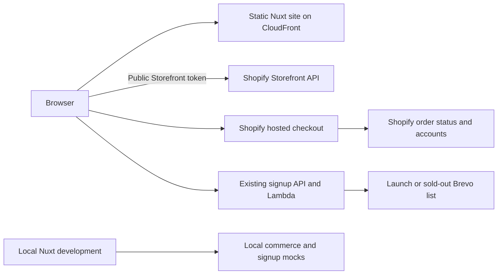

# Shopify integration — session plan

**Updated:** November 16, 2026. **Next:** Session 2, static deployment preparation.

This is the current ecommerce plan. The user requested frontend work first so
the design and purchase states can be iterated locally, followed by separate
Codex sessions for the remaining integration work. Session 1 is implemented locally,
including mocks and direct Shopify access. The owner reports public-token access
working in local preview; the generated beta purchase flow is not yet verified.
No deployment has been performed as part of this implementation.

## Start a fresh session

Read this document's current state, decisions, contracts, and the selected
session. Read that session's listed source files and applicable AGENTS.md
instructions. Use `git status` before editing; preserve existing changes.
Do not reread every historical milestone plan or redo the completed API proof.
Work on the selected session only, update its handoff, and leave a specific
next action. If a session needs splitting, record the boundary and remaining work.

Copy this for the next session:

> Implement Session 2 in docs/plans/shopify-integration-plan.md, using the Session 1
> handoff and shared types. Prepare public-token static commerce builds, artifact
> validation, and policy route support in the publisher and edge router. Document
> Shopify-side purchase controls. Preserve existing signup and hosting; no custom
> commerce backend is needed. Run local checks and update the handoff. Do not deploy.

For subsequent sessions, replace the session number and use its scope below.
Plans describe intended work; they are not evidence that it is deployed.

## Current state and evidence

| Item | Recorded state |
| --- | --- |
| Public site | `flatgirl.net`, existing waitlist, statically generated Nuxt/Vue and plain CSS on S3/CloudFront |
| Beta | `beta.flatgirl.net`, Basic Auth and noindex; independent static publication |
| Shopify API host | `tepwtx-zw.myshopify.com`; retain this working API identifier |
| Current customer-facing Shopify host | `flatgirl.myshopify.com`; accepted by the smoke test |
| Product / variant | `gid://shopify/Product/15491665297684` / `gid://shopify/ProductVariant/68124854681876` |
| Product facts observed in proof | USD 60.00, available for sale; Shopify is the price/availability authority |
| API version | Smoke test pins Storefront API `2026-10`; recheck support when implementing |
| API proof | Owner confirmed test purchase through confirmation email on November 16 |
| Public-token frontend | Owner reports working locally; mocked browser checks cover direct policy requests and no private fallback; generated beta checkout remains unverified |
| Policies | Owner reports all policies entered in Shopify; final launch review remains |
| Order-status verification | Access from the email link in a fresh/private browser is not yet explicitly confirmed |
| Payments | Owner enabled test mode; recheck actual setting before each live test and launch |
| Local commands | `make shopify-check` reads product; `make shopify-test` creates one-unit cart and opens checkout; private token prompt, no saved credential |
| Brevo | Launch lists beta **5**, production **4**; sold-out list IDs not created/recorded |
| Meta | Existing edge `ViewContent` and signup `Lead` CAPI pipeline; no implemented purchase sender in that pipeline |
| Domains | `checkout.flatgirl.net`, `shopify.flatgirl.net`, and separate `account.flatgirl.net` are proposals, not completed configuration |

The password/redirect-theme problem occurred during the first proof and was
subsequently overcome by the owner. Its exact resolution is not recorded. Preserve
the working Shopify setup; do not repeat historical password workarounds merely
because they appear in [SHOPIFY.md](../SHOPIFY.md).

At plan creation, Makefile/docs changes and the Shopify proof script/tests are
uncommitted. Treat them as existing work, not generated files to discard.

## Decisions and scope

1. Keep Nuxt, Vue, plain CSS, the image pipeline, carousel, photo viewer, and
   static AWS hosting. Call the Shopify Storefront API directly from the browser
   using the public Storefront token. No custom commerce backend, Hydrogen
   migration, or production Nuxt server is needed for this release.
2. Sell one configured blanket variant through quantity selection and **Buy now**.
   Shopify owns pricing, stock enforcement, checkout, payments, orders, order
   emails, and hosted order/account pages. No local cart drawer, customer login,
   Customer Account API, or payment collection in our frontend.
3. Keep Brevo launch subscriptions and add a distinct sold-out audience. The
   owner manually sends restock/next-drop campaigns. No Brevo product sync,
   restock automation, Shopify waitlist app, or new email engine.
4. Build and review locally, integrate on beta, then deliberately launch
   production. Preserve the waitlist path and archived production artifact.
   Use the existing store for the current prelaunch proof; do not require a
   second Shopify store to begin local work.
5. Keep provider-specific code small and isolated. A future Stripe/custom
   commerce replacement is out of scope; do not design a generalized commerce
   framework now. TikTok Shop is a separate sales-channel task, not a dependency
   for finishing the website.

The MSCHF reference guides a product/drop-focused presentation: strong imagery,
little navigation, a direct action, and an intentional sold-out page. It is not
a requirement to copy a site or add animation, product grids, or extra libraries.

## Session sequence

Estimates are hands-on engineering time, not promises of one uninterrupted agent
turn. They exclude account onboarding, design feedback, DNS propagation, and
operator availability. If a section grows, split it rather than expand its scope.

### Build

| Session | Outcome | Dependencies | Estimate | Status |
| --- | --- | --- | --- | --- |
| 1 | Local purchase UI, policy pages and deterministic mocks | Existing frontend | 5–7 hours | Implemented locally; ready for review |
| 2 | Static deployment preparation, checked locally | Session 1 public-token frontend | 1–3 hours | **Next** |
| 3 | Sold-out Brevo signup and local integration | Session 1 signup contract | 2–3 hours | Not started |

### Verify and launch

| Session | Outcome | Dependencies | Estimate | Status |
| --- | --- | --- | --- | --- |
| 4 | Beta deployment and full purchase/signup rehearsal | 1–3 | 2–4 hours | Not started |
| 5 | Branded checkout/accounts and return navigation | Working beta; domain decision | 1–2 hours plus DNS | Not started |
| 6 | Verified Meta and TikTok website purchase attribution | Working checkout, preferably final domains | 2–4 hours | Not started |
| 7 | Production launch and rollback rehearsal | 4–6; explicit deferrals recorded | 1–2 hours | Not started |

Optional Session 8: TikTok Shop onboarding, inventory/order synchronization, and
fulfillment rehearsal, about 2–4 hours plus platform review. It can proceed once
product policies and fulfillment timing are settled, independently of launch.

## Shared architecture and contracts

Session 1 implements the shared types and local endpoints below. In public-token
mode, `useCommerceRequest.ts` calls the shared Shopify adapter directly in the
browser and normalizes results into the same response contract. The local Nuxt
endpoints remain useful for fixtures and optional private-token development; no
production `/commerce` API is planned. See the Session 1 handoff for policies.



### Rendering and environment boundaries

Keep the product story and image HTML prerendered. Fetch commerce state after
rendering; do not block the page shell or photos on Shopify. Make the purchase
area stable in size during loading. Avoid a hardcoded second price in prose when
commerce is active. Display a useful no-JavaScript message; never render a fake
working checkout link in a static fallback.

Use an explicit public storefront mode: `waitlist` (default for generated builds)
or `commerce`. Session 1 can default **development only** to mocked commerce.
Use a narrow service/composable boundary so mocks and live endpoints share types
and components. Local scenario selection must have no effect in published builds.

Session 2 must remove the current requirement for `FLAT_GIRL_COMMERCE_ENDPOINT`
when a public Storefront token is configured. That build guard is still present.
The public token is intentionally included in the static artifact; private
Storefront/Admin tokens must never be included. The adapter currently reports
`salesOpen: true` in Shopify mode; waitlist mode is presentation, not a sales lock.

Keep `nitro.preset = 'static'`. Nuxt `server/api` endpoints are local development
mocks, not deployed services. Guard them with `import.meta.dev`. The publisher
must reject mock endpoint/settings, localhost handoffs, and fixture data in live
commerce artifacts. Never put the private token in public runtime config.

### Product and checkout adapter contract

Production uses direct Shopify GraphQL calls. Local fixture/private-token
equivalents remain `/api/commerce/product` and `/api/commerce/checkout`. Status
codes below are the normalized frontend/local endpoint contract, not proposed
AWS routes.

Product response:

```json
{
  "schemaVersion": 1,
  "salesOpen": true,
  "product": {
    "id": "gid://shopify/Product/15491665297684",
    "variantId": "gid://shopify/ProductVariant/68124854681876",
    "title": "Boring Flat Girl Plush Blanket",
    "availableForSale": true,
    "quantityAvailable": 327,
    "price": { "amount": "60.00", "currencyCode": "USD" }
  },
  "quantityLimit": 5
}
```

`quantityLimit: 5` is the owner-approved UI cap. If it must be a hard purchase
limit, verify and configure enforcement in Shopify before launch. Browser checks
can be bypassed; a custom proxy would not prevent direct public-token requests.
`quantityAvailable` is the sellable online quantity or `null` when unavailable;
327 is only a local fixture, never a production fallback. The edition size is 500. Use decimal strings or minor units for
money, not floating-point price comparisons. The initial market is US/USD as
used in the proof; shipping destinations must be confirmed before launch.

Checkout adapter input:

```json
{
  "quantity": 1,
  "expectedUnitPrice": { "amount": "60.00", "currencyCode": "USD" }
}
```

The shared adapter selects the configured product/variant and obtains authoritative
pricing from Shopify. The expected price only detects a stale display; it never
sets the price charged. On success return `201` with `{ "checkoutUrl": "..." }`.
Do not persist cart secrets in static artifacts, logs, or analytics.

| Response | UI behavior |
| --- | --- |
| `400 INVALID_REQUEST` | Explain invalid quantity; preserve editable selection |
| `409 SOLD_OUT` / `QUANTITY_UNAVAILABLE` | Refresh availability; show sold-out signup or permit a lower quantity |
| `409 PRICE_CHANGED` | Refresh price, announce change, require another Buy now click |
| `403 SALES_CLOSED` | Show launch-notification state; no checkout handoff |
| `429 RATE_LIMITED` / `503 UNAVAILABLE` | Retryable message; never label an outage as sold out |

Use a stable error envelope such as `{ "error": { "code": "SOLD_OUT" } }`.
Inspect HTTP and GraphQL errors, cart warnings, final line variant/quantity, and
cost before returning checkout. Keep warnings conservative until explicitly
classified. Reject unsafe checkout URL schemes, credentials, ports, and hosts;
use the exact configured allowlist, including the two current myshopify hosts.

Disable repeated submission while a request is pending. Do not automatically
retry `cartCreate` after a timeout: the upstream operation may have succeeded.
A manual retry may create another abandoned cart, not a second order. Checkout
still performs the final stock and shipping checks; a cart is not a reservation.

### Frontend states

| State | Visible behavior |
| --- | --- |
| Waitlist / sales closed | Current launch form and accurate prelaunch copy |
| Loading | Photos/story visible; neutral purchase-area loading state |
| Available | Formatted Shopify price, quantity, Buy now |
| Submitting | Pending feedback, disabled duplicate submission, retained quantity |
| Sold out | Price/shipping and struck-through zero stock remain; disabled Buy now and zero quantity controls, no fulfilment text; separate sold-out signup |
| Request failed | Inline retry, no false sold-out claim or lost form input |
| Price or stock changed on Buy | Refresh/announce change before another action |

No invented countdown, stock scarcity count, or promised restock date. Confirm
whether sold-out copy promises only a possible restock or includes future drops.

### Signup compatibility

Extend `/subscribe` with a bounded `purpose: "launch" | "sold_out"` field.
Missing purpose means `launch` so old cached pages keep working. Existing fields
remain `email`, `turnstileToken`, and the empty honeypot `website`. Keep the same
public acknowledgment for new, existing, or suppressed contacts.

The currently deployed handler rejects extra request fields. Until the Session 3
backend is deployed, launch submissions must keep omitting `purpose`; only the
local mock may accept it during Session 1. Do not enable real sold-out submissions
until the matching backend and list mapping exist. This keeps a routine waitlist
build from breaking the existing signup service between sessions.

Resolve purpose to list ID on the server; never accept an arbitrary Brevo list
ID from the browser. Existing launch lists remain beta 5 and production 4.
New beta and production sold-out list IDs must be explicitly configured.
Reusing one Brevo account still shares contacts and global suppression.

An eligible launch-list member can join the sold-out list without recreating
their contact. Preserve global/list suppression, unrelated memberships, consent
group handling, and duplicate protections. Do not subscribe a buyer simply
because they checked out, or send the launch welcome workflow to sold-out signups.

## Session 1 — local storefront UI first

**Outcome:** the user can iterate on the actual product page and every purchase
state locally, without Shopify credentials, AWS, Brevo writes, or outbound tracking.

**Read:** `web/nuxt.config.ts`, `web/app/app.vue`,
`web/app/components/SignupForm.vue`, `web/app/assets/css/main.css`,
`web/server/api/subscribe.post.ts`, `web/playwright.dev.config.ts`,
`web/tests/page.spec.ts`, `web/tests/dev/signup.spec.ts`, `docs/DEVELOPMENT.md`.

**Implement:**

1. Add small typed commerce contracts, a composable/service, and a purchase
   component. Keep UI markup independent of Shopify GraphQL. Preserve the current
   photography, responsive layout, typography, carousel, and photo viewer.
2. Implement quantity/price/Buy now, loading, submitting, retry, sold-out, and
   sales-closed states. Reuse SignupForm with parent-provided copy, endpoint and request fields.
   The form has no launch/sold-out mode or purpose prop. Extend only its local mock in this session.
3. Add deterministic development fixtures for available, sold out, sales closed,
   delayed/error responses, and stock/price changes during purchase. Choose a
   documented dev-only environment setting or query switch. Add no developer
   controls to the customer UI. Successful mock checkout must visibly simulate
   a handoff on localhost, never open Shopify or suggest a real order was placed.
4. Preserve default generated waitlist behavior. Add narrow tests around state
   transitions, quantity bounds, malformed responses, double clicks, signup
   purpose, and retry. Test both dev mode and generated static markup; browser
   interception can provide mocked commerce responses to static previews.
5. Document exact local commands/scenarios and the implemented contract. Record
   mobile/desktop review and baseline versus changed JS/CSS transfer sizes.

**Done when:** a developer can open the local page and exercise all listed states
without tokens; valid input survives failures; keyboard/focus/live-region behavior
works; a mock purchase cannot call Shopify; generated output keeps mocks out.
The standard generation remains waitlist mode until live configuration is wired.

**Checks:** `npm run typecheck --prefix web`, `npm run generate --prefix web`,
appropriate existing carousel/viewer/signup tests, and focused new commerce
browser tests. Add/document a `test:commerce:dev` script if helpful. Do not rerun
unrelated infrastructure checks. Use existing image preparation and offline
Turnstile fixtures; ordinary dev Turnstile may still require connectivity.

**Handoff:** exact preview command, fixture controls, changed files, UI decisions,
actual API types, tests/results, bundle comparison, unresolved design choices.
No backend, secret storage, DNS, or external app setup in this session.

### Session 1 implementation handoff — November 16, 2026

Implemented locally; no deployment or provider configuration. Review at
`http://localhost:3000/` using `npm run dev --prefix web`. Default development
uses local commerce; `/?commerce=waitlist` restores the launch form. The
existing interactive dev server was reused and left running.

**Current UI decisions:**

- Product story, photos and heading remain. Temporary product details removed.
- Unit price, then **Free Shipping! on its own line**. No subtotal, shipping
  explanation, cart UI, or Shop Pay/installment messaging.
- Real-stock contract displays `N of 500 remaining`; unknown quantity omits the
  count. Quantity starts at 1 and stops at the lesser of stock, API cap and 5.
- **Fulfilment by Christmas*** uses a plain-text asterisk (not a hyperlink).
  Its note is at the bottom of the product page. Final dispatch-versus-arrival
  wording remains a launch content decision.
- Five centered policy links below the Polis credit. Policy pages use a 64 × 64
  rounded Flat Girl logo beside bold **Back to blanket**. Legal Notice is deferred
  pending applicable business requirements.

**Purchase/signup ownership:** `index.vue` owns the single commerce state and
selects sold-out signup, launch signup when closed, or no signup. `PurchasePanel`
accepts product/quantity inputs and emits Buy now; it contains no signup forms.
It stays visible when sold out: price and shipping remain, zero stock is struck
through, Buy now is disabled, and quantity shows zero with both buttons disabled.
Fulfilment and its footnote are hidden; signup is spaced below the panel.
Waitlist-only mode does not fetch commerce data.

**Editable inputs:** `web/app/content/storefront.ts` owns title, description,
shipping/Christmas copy, edition size and parent signup copy. `SignupForm` takes
`title`, `description`, `buttonLabel`, `successMessage`, `privacyText`, `endpoint`,
`siteKey`, optional `extraFields`, `enabled` and `unavailableMessage`. It has no
purpose enum or conditional launch/sold-out copy. Parents choose the copy and
request metadata. Launch requests omit purpose; local sold-out requests pass
`extraFields: { purpose: 'sold_out' }`. Mandatory email/token/honeypot fields
cannot be replaced by extra fields. Published sold-out submission stays disabled
until Session 3 is connected. Backend purpose-to-list validation remains required.

**Implementation:** `PurchasePanel.vue`, `useCommerce.ts`, `utils/commerce.ts`,
`shared/types/commerce.ts`, `pages/index.vue`, `SiteFooter.vue`, and
`pages/policies/[handle].vue`. Homepage content moved out of `app.vue` to enable
static policy routes. No new dependency. `nitro.preset` remains static.

**Actual contract:** product JSON above plus `quantityAvailable: number | null`;
`quantityLimit` is an integer 1–5. Money remains a decimal string in USD.
Checkout request and 201/error envelope are unchanged. Client validates product
shape and checkout hosts; explicit timeouts are 10 seconds for product/policies
and 15 seconds for checkout. Checkout never retries automatically. Conflicts
refresh state and require another action. Input survives failures, and focus
moves to signup when a purchase turns into sold-out/closed state.

**Policies:** public-token mode queries Shopify directly; the local equivalent
is `/api/commerce/policies/:handle`. Handles: `refund-policy`,
`privacy-policy`, `shipping-policy`, `terms-of-service`, `contact-information`.
Response: `{ schemaVersion: 1, policy: { handle, title, paragraphs: string[] } }`.
Missing policy returns 404 with `policy: null`. Text is escaped by Vue, not
rendered through `v-html`. Local drafts live only in the development server.
Contact details are deliberately not invented; privacy/contact placeholders and
other draft wording must be replaced with reviewed store policies before launch.

Shopify Storefront API supports all of these via `shop`, including `legalNotice`.
The shared adapter queries the pinned API version; these are the supported fields:

```graphql
query StorePolicies {
  shop {
    refundPolicy { title body url }
    privacyPolicy { title body url }
    shippingPolicy { title body url }
    termsOfService { title body url }
    contactInformation { title body url }
    legalNotice { title body url }
  }
}
```

The shared adapter sanitizes Shopify HTML into supported rich-text nodes plus
plain paragraphs. Never insert raw Shopify HTML into the page. Shopify remains
the editing source, so policy body changes are fetched without rebuilding. Local
notes, labels and route-list changes require rebuilding. Keep current no-store
fetches and unavailable/not-configured responses. Verify policy presence and
redirects before beta. References:
[Shop](https://shopify.dev/docs/api/storefront/latest/objects/Shop),
[ShopPolicy](https://shopify.dev/docs/api/storefront/latest/objects/ShopPolicy).

**Session 2 dependencies added by policy routes:** `tools/deploy_site.py` currently
rejects the new generated policy HTML/payload paths, and
`cloud/aws/lambda/edge-router.cjs` redirects extensionless paths to `/`.
Allow only the known policy output paths and map their URLs to the generated
index documents before beta. Test direct links, refreshes, cache rules, beta auth,
rollback, and existing redirects. Do not deploy the current artifact as-is.
The build rejects local/non-HTTPS commerce endpoint settings; publisher-side
manifest validation and runtime override validation are still Session 2 work.

**Before enabling live stock:** request `quantityAvailable`, verify inventory
scope and online sellable quantity, disable overselling, and account for any
replacement units kept aside. A cart is not an inventory reservation. No local
cart identifier is persisted.

**Local scenarios and checks:** see [DEVELOPMENT.md](../DEVELOPMENT.md#local-commerce-preview).
Validation: typecheck and both waitlist/commerce generation pass. Local browser
checks cover 20 commerce cases and 11 signup cases. Generated waitlist checks
cover 19 cases (four commerce-mode tests intentionally skipped); the explicit
generated-commerce run passes all five cases. All failed expectations were
resolved: legacy signup wording, the existing ten-photo carousel, Playwright's
noscript text filtering, and the new decorative policy logo. No carousel/viewer
implementation changed. Reviewed desktop (1280px), mobile (375px), and the policy
header visually. Final generated output is restored to default waitlist mode;
mock responses and mock-checkout code are absent from client assets.


**Bundle comparison:** sum of all generated `_nuxt` JS/CSS files, bytes; gzip
compresses each file separately with fixed metadata. This is a transfer-size
proxy, not a measured initial-page waterfall. It includes lazy policy/error chunks.

| Assets | Before raw / gzip | After raw / gzip |
| --- | --- | --- |
| JavaScript | 195,095 / 71,061 | 252,697 / 93,825 |
| CSS | 9,595 / 3,122 | 11,312 / 3,942 |

The increase includes Nuxt routing, purchase states and policy pages. Policy
links disable prefetch; photo assets and their preparation pipeline are unchanged.


### Follow-up: shared Shopify/local source — November 16, 2026

Owner requested live policy editing and one shared source switch. The local
Nuxt server now supports `FLAT_GIRL_COMMERCE_SOURCE=local|shopify` for products,
policies and checkout together. Private token is supplied in ignored `web/.env`
as `NUXT_SHOPIFY_STOREFRONT_TOKEN`. Signup remains a local Brevo mock. The current
local preview is configured for **Shopify**; source is not a payment-mode switch.

`web/shared/utils/shopify.ts` implements the pinned Storefront reads and cart
creation. `commerce-source.ts` shares selection and redacted errors across the
three local endpoint families. `parse5` was the server-side dependency added after
the initial Session 1 handoff. Shopify HTML becomes escaped paragraphs with
entities, lists and link URLs preserved; missing policies show as unpublished.
No fallback from a failed/missing Shopify policy to a local draft.

Verified read-only with the configured token: product USD 60.00, 499 sellable
units; privacy policy available, refund/shipping/terms/contact policies null at
the time of the check. These observations are not permanent stock/policy facts.
The password-protected store accepts the private Headless token; tokenless API
access returned “Online Store channel is locked.” No storefront password needed
for these API reads. Payment settings and publication were not changed. No live
cart/order was created during this verification; checkout validation is covered
by injected-response service tests.

The development browser suite now refuses non-local source before checkout tests.
Run `npm run test:commerce:service --prefix web` for the Shopify adapter's offline
checks. Browser reads verified current privacy content, missing-policy messaging
and live product stock. Typecheck and generation checked; private token and
server-only adapter/parser excluded from public output at that stage. The later
public-token implementation intentionally bundles the shared adapter/parser.

The original AWS commerce-backend proposal is superseded by the public-token
decision below. Session 2 now covers static build configuration, publisher
validation, policy URL routing and purchase-control planning. See DEVELOPMENT.md
for setup.


### Policy rich text follow-up — November 16, 2026

Shopify policies now include optional `content: PolicyNode[]` alongside the
existing `paragraphs` fallback. Nodes are `{ type: "text", text }` or
`{ type: "element", tag, children, href?, start? }`. See
`web/shared/utils/policy.ts` for the supported tags and runtime validation.
`policyContent()` in the Shopify adapter parses HTML into that restricted tree.
`PolicyRichText.vue` renders it using Vue text nodes and supported elements,
preserving headings, strong/emphasis, line breaks, lists, tables and safe links.
Scripts, handlers, arbitrary styles and unsafe URL schemes are not passed through.
This supersedes the earlier plain-paragraph-only rendering decision; no `v-html`.
Local drafts and older endpoint responses without `content` still render paragraphs.

Verified the owner's current Shopify refund policy retains bold DISCLAIMER/final
text and line breaks. Browser checks also covered list numbering, clickable links,
escaped markup and rejection of unsafe nodes. All 19 service tests, typecheck and
static generation pass.

### Public Storefront token decision — November 16, 2026

`NUXT_PUBLIC_SHOPIFY_STOREFRONT_PUBLIC_TOKEN` now selects direct browser Shopify
requests for products, policies and cart creation when the source is `shopify`.
The private token is not used as a fallback. Both transports share validation and
rich-text sanitization. The owner reports public-token access working in local
preview. Typecheck, static generation and 21 adapter tests passed; a mocked
static-browser check verified direct public-header requests, rich text and no
private fallback on failure. This does not establish a completed beta purchase.

Use public-token browser access for this release. Drop the custom commerce
Lambda/API Gateway routes, private-token SSM storage/rotation, proxy buyer-IP
forwarding, proxy throttling and proxy-specific logging/metrics from Session 2.
Existing signup infrastructure remains required. Purchase restrictions must be
verified in Shopify, rather than relying on a hidden button or a private proxy.
See `docs/DEVELOPMENT.md` for local setup.

## Session 2 — static deployment preparation

**Outcome:** public-token static commerce artifacts can be built, validated and
published with working policy routes; implementation checked locally, no deployment.

**Read:** Session 1 handoff and public-token decision; `web/nuxt.config.ts`,
`web/app/composables/useCommerceRequest.ts`, `web/shared/utils/shopify.ts`,
`tools/deploy_site.py`, related build/manifest tests, `cloud/aws/lambda/edge-router.cjs`,
`cloud/aws/lib/access.ts`, `config.ts`, `docs/ACCESS.md`, `docs/DEPLOYMENT.md`,
and `docs/SHOPIFY.md`.

**Implement:**

1. Allow commerce builds with the public Storefront token without requiring
   `FLAT_GIRL_COMMERCE_ENDPOINT`. Carry the intended public settings through the
   build and deployment manifests. Preserve default waitlist builds and the
   optional private-token local development path; no silent private fallback.
2. Update artifact/environment validation to reject mock/local settings, missing
   public commerce configuration, unsafe checkout hosts and beta/production
   mismatches. Keep private credentials out of artifacts. Preserve compatibility
   with older waitlist releases for rollback.
3. Allow the known generated policy HTML/payload paths in the publisher and map
   their URLs to the correct documents in CloudFront. Verify direct links,
   refreshes, trailing-slash behavior, caching, beta Basic Auth, existing redirects
   and rollback. Do not broadly allow arbitrary generated paths.
4. Document the intended Shopify-side sales opening/closure procedure and decide
   whether the five-item cap requires hard enforcement. Record what the current
   store supports and any unresolved requirement. Frontend waitlist mode and
   quantity validation do not prevent direct API use or invalidate issued checkout
   URLs. Prepare the procedure here; verify it on beta in Session 4 and at launch
   in Session 7 without changing live Shopify settings in this session.
5. Prepare the beta build/deploy/rollback commands and focused checks for generated
   public-token commerce and policy pages. Preserve the existing signup service;
   no commerce Lambda, private-token secret storage, new commerce API routes, or
   proxy-specific operations tooling is required.

**Done when:** local checks prove that public-token commerce builds without a
backend URL; artifacts contain no private credentials or mock settings; policy
routes and previous waitlist rollback work; and purchase-control decisions and
remaining Shopify verification are documented. This session does not claim beta
checkout, payment or signup delivery success.

**Checks:** typecheck and waitlist/commerce generation; focused artifact/publisher
and edge-router tests; relevant existing frontend adapter/browser tests. Run
`npm run check --prefix cloud/aws` when modifying AWS routing/infrastructure.
Use intercepted Shopify responses for repeatable local purchase tests; do not
create live carts/orders through automated tests. Prepare deployment commands,
but leave rollout and real customer-flow verification to Session 4.

**Handoff:** public config/build inputs, manifest/routing changes, local test
results, deployment/rollback commands, and Shopify-side control decisions or
unresolved requirements. No deployment in this session.

## Session 3 — sold-out Brevo audience

**Outcome:** the existing signup service supports separate launch and sold-out
audiences without introducing product-alert automation.

**Read:** Session 1 signup contract; `docs/SIGNUP.md`, `docs/NOTIFICATIONS.md`,
`cloud/signup.json`, `cloud/aws/lib/signup-config.ts`,
`cloud/aws/lambda/signup.cjs`, notification worker, `tools/signup.py`,
`tools/check_signup.py`, signup infrastructure/browser/operator tests.

**Implement:**

1. Configure distinct beta/production sold-out lists once actual IDs are supplied.
   Use visibly invalid/unset configuration until then, not guessed IDs. Keep live
   sold-out collection disabled while its destination is missing.
2. Implement the backward-compatible purpose field and server-side list mapping.
   Refactor existing hardcoded 5/4 assumptions across runtime, tools, build
   validation, and tests without changing launch-list behavior.
3. Preserve suppression/duplicate behavior. Test new contact, existing launch
   subscriber, existing sold-out subscriber, suppressed contact, invalid token,
   unknown purpose, provider timeout, and legacy requests without purpose.
4. Decide explicitly how a successful sold-out membership affects owner SES
   notifications and Meta Lead counts. Prefer audience-aware labels and one
   event per successful new target membership; confirm this metric definition.
   Version queue payloads compatibly if they change, and keep failure delivery
   decoupled from successful signup. Do not silently inflate unique-person metrics.
5. Update frontend copy, local mocks, runbook, and tests. Confirm in Brevo that
   adding this membership does not trigger the existing launch welcome email.
   The owner controls campaigns; this session does not send a restock campaign.

**Done when:** both purposes pass local tests; old forms work; an existing launch
subscriber can express sold-out interest; suppression is preserved. Actual Brevo
delivery/list checks remain pending until Session 4 if no live setup occurred.

**Checks:** relevant signup unit/infrastructure/Python tests and
`npm run test:signup --prefix web`, plus dev/browser coverage for both purposes.

**Handoff:** list IDs or missing inputs, automation configuration, notification/
Lead semantics, regression evidence, and required beta rollout steps.

## Session 4 — beta wiring and end-to-end rehearsal

**Outcome:** the actual beta page reaches Shopify checkout and the correct Brevo
audiences, while production continues to serve the waitlist.

**Read:** handoffs 1–3, `docs/ACCESS.md`, `docs/DEPLOYMENT.md`, `docs/SHOPIFY.md`,
`docs/SIGNUP.md`, current environment configuration and deployment manifests.

**Execute:**

1. Verify account/profile, Shopify product/variant/market, public Storefront token,
   test payment setting and controlled email recipients. Deploy the prepared
   policy routing and required signup changes in the established order. Beta
   Basic Auth protects the website, not direct Shopify API access; a public token
   is intentionally visible. Do not invent a private commerce API to protect it.
2. Build and publish commerce mode to beta only. Validate direct Shopify requests,
   signup endpoint, allowed checkout hosts, account URL if configured and artifact
   provenance. Test the generated static site against Shopify and the signup
   service, not the local Nuxt server. Verify policy direct links and refreshes.
3. Exercise successful checkout, declined payment, blocked shipping destination,
   timeout/retry, stale price, stock/quantity change, and sales closure. Use a
   test product/variant configuration for destructive stock/price scenarios.
   Verify guest checkout and order status in a fresh browser and on mobile. Check
   Shopify-side quantity/sales restrictions independently of frontend controls,
   including an already-open page and an already-issued checkout URL.
4. Submit controlled launch/sold-out signups, including existing and suppressed
   contacts. Verify beta list membership, intended email behavior, owner alerts,
   and unchanged production audiences. Record only non-sensitive evidence.
5. Record latency, failed requests, script/asset sizes, and the no-JavaScript
   fallback. Rehearse restoring the prior beta artifact; account for any changed
   Nuxt payload files and new public routes in the publisher's restrictive
   allowlist. Confirm production site/signup still work.

**Shared-store constraint:** separate API tokens and AWS environments do not
isolate Shopify inventory, orders, payment mode, or channel analytics. Do not
toggle test mode on this store after real sales begin. Document how beta purchase
creation will be disabled at launch; use mocks or a genuinely separate Shopify
test store for ongoing purchase tests afterward.

**Done when:** a purchase originating from beta is confirmed as a test order,
the email and order-status link work, the sold-out form reaches only the intended
audience, failure states are usable, beta page access is protected, and the
public-token flow works without a private credential or local API. Successful
API reads alone do not satisfy this session.

**Handoff:** deployed release/stack/config identifiers, test matrix with observed
results, remaining failures, beta auth procedure, and safe rollback commands.

## Session 5 — domains and Shopify-hosted customer experience

**Outcome:** checkout, order status, emails, and return navigation use a coherent
brand without adding a custom customer-account implementation.

**Read:** current Shopify runbook, beta handoff, domain/DNS configuration,
deployment/access guides, and current Shopify account-domain documentation.

**Execute:**

1. Confirm the owner's final hostname choice. Recommended target is
   `checkout.flatgirl.net` for checkout and `account.flatgirl.net` for accounts
   and order status. `shopify.flatgirl.net` remains an alternative, not an agreed
   change. `flatgirl.myshopify.com` remains usable during implementation.
2. Verify how this store's primary Online Store and Customer Accounts domain
   targets interact. Configure Shopify, only the required DNS records, and TLS
   verification; preserve apex/www AWS hosting and all mail records. Never replace
   Shopify's returned checkout hostname by string manipulation.
3. Set the connected account domain as primary for Customer Accounts. Add the
   verified hosted orders/account link to the frontend; no OAuth or Customer
   Account API integration. Configure checkout/account branding and support links.
4. Verify new and prior order-email links, guest verification, account login,
   logo/continue-shopping navigation, and redirect-theme behavior. Ensure an
   unused Shopify storefront redirects appropriately without redirecting checkout,
   password entry, or account pages into broken Nuxt routes.
5. Update checkout host allowlists, smoke-test expectations, build configuration,
   and the runbook. Record the actual domain choices and DNS/Shopify state.

Shopify documents a distinct customer-account domain covering order-status
pages. Confirm the exact UI and prerequisites for this store before DNS edits.
[Account-domain reference](https://help.shopify.com/en/manual/customers/customer-accounts/customize-customer-accounts/connect-domain-customer-account)

**Done when:** customer links resolve with valid TLS and correct navigation from
fresh browser sessions. If custom-domain verification is delayed, explicitly
record whether launch will use the tested myshopify host; do not block local work.

**Handoff:** connected/primary domains, validated return paths, configuration
changes, propagation status, and any outstanding user-facing issue.

## Session 6 — Meta and TikTok website attribution

**Outcome:** one purchase is measured once with correct value, currency, product
identity, and useful attribution across the custom frontend/Shopify boundary.

**Read:** `docs/META.md`, `cloud/aws/lambda/meta.cjs`, `meta-worker.cjs`,
`edge.cjs`, `edge-router.cjs`, existing analytics tests/admin metric assumptions,
plus Shopify's Meta channel and TikTok's current integration documentation.

**Execute:**

1. Inventory actual configured pixels/datasets and integrations. Preserve the
   existing production Meta dataset. Keep `ViewContent` and `Lead` ownership
   explicit; a Shopify plugin does not automatically instrument Nuxt pages.
2. Prefer Shopify's Meta integration for Purchase and TikTok's Shopify integration
   for web checkout/purchase tracking. Decide whether cart/checkout-intent events
   are useful for Buy now and define their exact trigger. Never label a button
   click or cart creation as a purchase.
3. Verify ad-click/UTM and supported identity handoff, consent behavior, value/
   currency semantics, catalog product-ID mapping, and customer navigation across
   domains. Existing `_fbc` handling alone is not proof of checkout attribution.
   Configure synced catalog destination links to the real Flat Girl product page.
4. Test duplicate delivery, reload/back navigation, blocked browser tracking,
   declined payments, and isolation of beta events. Shopify channel settings are
   store-wide: separate AWS datasets do not automatically isolate Shopify test
   orders. Establish a safe test-events procedure; record limitations instead of
   assuming every test order will produce production-like ad reporting.
5. If Shopify's native integration cannot meet the headless requirement, document
   evidence before adding a custom purchase path. A fallback needs verified Shopify
   webhook signatures, durable deduplication/retries, a deliberate paid-order
   trigger, test-order handling, and coordinated event IDs. Do not run two
   independent Purchase senders. Purchase tracking failure must not break buying.

Shopify documents server-side purchase sharing through its Meta channel, but
this storefront's end-to-end attribution still needs observed verification.
[Meta data sharing](https://help.shopify.com/en/manual/promoting-marketing/analyze-marketing/meta-data-sharing)
and [TikTok on Shopify](https://ads.tiktok.com/resources/help/article/tiktok-app-shopify?lang=en).

**Done when:** record actual event ownership and test evidence, including any
platform test-mode limitations. If an ad platform is deferred, record that it is
not ready for paid conversion campaigns rather than silently marking it complete.

**Handoff:** provider/event ownership table, configured IDs (no tokens), consent
and matching decisions, deduplication results, known limitations, and launch checks.

## Session 7 — production launch and recovery

**Outcome:** reviewed production ecommerce release with accurate availability,
working hosted checkout/order status, and a practiced recovery path.

**Read:** all completion handoffs, current deployment/signup/Shopify/Meta guides,
production config, and the selected release manifest. Use a dated workflow for
the actual launch, linked from `docs/workflows/README.md`.

**Execute:**

1. Resolve the release inputs below. Verify stock, market/shipping settings,
   tax configuration, support contact, return/privacy/shipping policies, and exact
   delivery promise. Confirm the intended launch time with the owner; do not infer
   it from historical November/Black Friday copy. Clean committed source is an
   existing production-build requirement; do not commit unrelated changes.
2. Prepare production public-token build configuration, signup service settings
   and real sold-out list IDs. Keep purchases closed using the verified Shopify
   procedure. Confirm existing monitoring has an actionable destination and
   configuration matches the production artifact. Disable beta purchase testing
   against the shared store at cutover; hiding beta UI does not isolate Shopify.
3. Rehearse Shopify-side closure and static rollback on beta. Archive the current
   waitlist release. Verify behavior with a previously loaded page and an issued
   checkout URL, including other active sales channels. Restoring HTML does not
   reverse orders, membership changes, emails, analytics or Shopify availability.
4. At the agreed launch, follow a concrete order for Shopify access/test-mode
   changes, Shopify-side sales enablement, and static publication. Shopify must be ready
   before exposing Buy now. Verify this store's actual first-launch/password state;
   do not assume a password page can stay enabled for public headless checkout.
   Remove production noindex, use canonical flatgirl.net, and finalize accurate
   metadata. A launch campaign is a separate owner-controlled send.
5. Verify product, purchase path, sold-out signup, order access, provider events,
   and metrics immediately after publication. A real-payment test/refund, if
   requested, must be explicitly planned and may incur fees. Watch errors during
   the drop; verify the natural sellout routes visitors into the correct list.

**Done when:** live production checks are recorded, payment mode and stock are
correct, no mocks/test-only paths are deployed, rollback is executable, and the
owner has the operating commands. Record any waived check and its practical limit.

**Handoff:** release/time, final configuration, verified customer paths, campaign
status, monitoring owner, rollback/closure procedure, and deferred work.

## Optional Session 8 — TikTok Shop

**Outcome:** eligible TikTok-native orders enter Shopify with verified inventory
and fulfillment behavior. This is distinct from TikTok ads sending buyers to
flatgirl.net and from the website's TikTok Pixel/Events API.

Confirm seller eligibility, product/return policies, and dispatch requirements
against the blanket's actual fulfillment schedule. Connect the channel, select
the intended catalog, and test order/inventory synchronization and handling of
returns/refunds/cancellations in TikTok Seller Center. Shared stock and potential
sync delays need a deliberate allocation decision for the limited run; do not
promise cross-channel stock isolation or instantaneous synchronization.

**Read:** current [TikTok Shop setup](https://help.shopify.com/en/manual/online-sales-channels/social-commerce/tiktok/setup)
and [order management](https://help.shopify.com/en/manual/online-sales-channels/social-commerce/tiktok/orders).
**Done when:** onboarding is accepted and the operational test is recorded.
Otherwise retain the explicit blocker/status without delaying unrelated site work.

## Inputs needed later — not blockers for Session 1

| Decision/input | Needed by | Default for local work |
| --- | --- | --- |
| Final checkout/account hostname | Session 5 | Current myshopify checkout; no invented account link |
| Public Storefront token in deployment configuration | Session 2 build; Session 4 beta | Owner reports local access working; no private-token AWS storage needed |
| Sold-out list IDs and audience wording | Session 3 live setup | Mock purpose; no external writes |
| Per-order quantity cap and allowed destinations | Session 4 | Fixture cap 5; US/USD |
| Launch time, delivery promise, policies, and payment readiness | Session 7 | Preserve known facts; no invented deadlines |

Meta/TikTok account access and data-sharing configuration are Session 6 inputs.
Do not request all external credentials or business decisions before the local
UI can be reviewed. Read connected configuration/runbooks before asking again.

## Session handoff template

Append a dated entry after each implementation session and update the sequence
table. Use separate local/deployed/owner-verified statuses where they differ.

```text
Session N — YYYY-MM-DD — complete / partial / blocked
Outcome and changed files:
Contract/configuration decisions (actual names; no secrets):
Checks run and results; manual evidence and limits:
Deployment status; external actions and effects:
Open issues and exact next-session starting point:
```

### Initial planning handoff — November 16, 2026 (historical)

Superseded by the Session 1 and public-token handoffs above.

Plan written; implementation sessions have not started. API proof and owner
confirmation email success are preserved as prior evidence. The next session
is **Session 1**, entirely local UI/mocks. No DNS, AWS, Shopify, Brevo, or social
account changes were made by this planning session.

## Technical references

Recheck API versions/platform behavior when implementing, especially domain,
payment-mode, and social-channel configuration.

- [Shopify product query](https://shopify.dev/docs/api/storefront/latest/queries/product)
- [Cart creation and warnings](https://shopify.dev/docs/api/storefront/latest/mutations/cartCreate)
- [Cart handling and checkout handoff](https://shopify.dev/docs/storefronts/headless/building-with-the-storefront-api/cart/manage)
- [Test orders](https://help.shopify.com/en/manual/checkout-settings/test-orders)
- [Shopify Payments test mode](https://help.shopify.com/en/manual/payments/shopify-payments/testing-shopify-payments)
